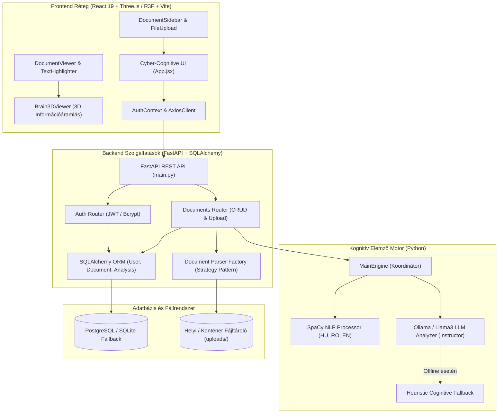

# 🧠 NeuroRead – Átfogó Rendszerdokumentáció és Fejlesztési Krónika

> **Kognitív Szövegelemző és 3D Agyi Információáramlást Vizualizáló Platform**  

## 1. Vezetői Összefoglaló és a Projekt Célja

A NeuroRead egy kognitív tudományokra és mesterséges intelligenciára támaszkodó webes platform, amelynek rendeltetése a különböző formátumú szöveges dokumentumok (PDF, DOCX, TXT) feldolgozása, és az emberi agyban történő **kognitív terhelés** szimulálása és 3D-s vizualizációja valamint a szövegben feltűnő nehezebb részek kijelölése és egyszerűsítése.

Hagyományos helyesírás- vagy stílusellenőrző rendszerekkel ellentétben a NeuroRead nem pusztán szintaktikai hibákat keres, hanem a neurobiológiai és pszicholingvisztikai folyamatokat modellezi:
- **Többnyelvű NLP Elemzés (SpaCy):** Szintaktikai fa mélység, mondathossz, ritka szavak és standard olvashatósági indexek (Flesch, Fog, SMOG) kiszámítása magyar, román és angol nyelven.
- **Szemantikai LLM Elemzés (Ollama / Llama3 + Instructor):** A szöveg logikai nehézségének, absztrakciós fokának és munkamemória-igényének kinyerése szigorúan típusos Pydantic modellekkel.
- **3D Neurális Információáramlás (Three.js / React Three Fiber):** Az olvasott szövegrészek nehézségének függvényében egy 3D agymodellen keresztül mutatja be, hogy az információ miként áramlik az érzékelési (Visual Cortex) és beszédértési (Wernicke), nyelvtani feldolgozási (Broca), valamint a döntéshozó/munkamemória (Prefrontal Cortex) központok között.
- **Kettős Áramlási Karakterisztika:** Könnyű, gördülékeny szövegnél nyugodt, zöld/cián lamináris részecskeáramlás; komplex, nehezen emészthető szövegnél fokozott sebességű, vörös/borostyán turbulens áramlás és visszacsatolt hibajavító hurkok (feedback loops) láthatók.

---


## 2. A Fejlesztés Fázisainak Részletes Elemzése

#### I. Fázis: Projektindítás és Szövegbontó Stratégiák (2026. szeptember 23 – 28.)
- **PitoPanna** inicializálta a git tárolót, lefektette a `schemas` struktúrát és a többnyelvű NLP pipeline követelményeit.
- **torsi1** bevezette a szoftvertervezési minták közül a **Strategy Pattern**-t a dokumentumok beolvasására (`BaseParser`, `PDFParser`, `DocxParser`, `TxtParser`), amely lehetővé teszi tetszőleges új fájlformátum zökkenőmentes csatlakoztatását a jövőben.

#### II. Fázis: Hibrid MI Motor és Adatbázis Kapcsolat (2026. szeptember 30.)
- Megszületett a hibrid kognitív megközelítés: a determinisztikus statisztikai metrikák (SpaCy szintaktikai fa mélység, ritka szavak) kiegészültek a generatív nagy nyelvi modellel (Ollama/Llama3).
- **PitoPanna** megalkotta a `MainEngine` osztályt, amely összefésüli az NLP és LLM kimeneteket egységes `HighlightedSegment` és `CognitiveModel` struktúrába.
- **torsi1** konfigurálta a PostgreSQL kapcsolatot SQLAlchemy modellekkel (`User`, `Document`, `AnalysisResult`).

#### III. Fázis: Kognitív Olvasó és Hitelesítés (2026. október 06.)
- A frontend megkapta az első kognitív szövegkiemelőt, amely a mondatokat nehézségi szintjük szerint zöld, kék, narancs és vörös árnyalatokkal festi meg.
- Létrejött a biztonságos JWT token alapú beléptető és regisztrációs rendszer, melyhez automatikus Axios token-injektálás és elegáns modális ablak társult.

#### IV. Fázis: A 3D Szinaptikus Tér Megszületése (2026. október 09 – 12.)
- Megtörtént az agyi koordináták backend oldali integrálása (`BrainActivation`, `SynapseFlow`), majd a React Three Fiber segítségével a háromdimenziós szinaptikus háló beépítése a kliensbe.
- A kezdeti WebGL és R3F canvas referenciaproblémákat **torsi1** orvosolta.

#### V. Fázis: Adatkezelés és Felhő-felkészítés (2026. október 13 – 17.)
- Megvalósult a teljes dokumentum-életciklus kezelése (CRUD), perzisztens dokumentumlista oldalsávval.
- Elkészült a többkonténeres Docker architektúra (`docker-compose.yml`), elkülönített PostgreSQL, FastAPI és Nginx/React konténerekkel.

#### VI. Fázis: Dinamikus Információáramlás és Cyber-Cognitive UI (2026. október 17)
- Az agymodell teljes megújítása (**PitoPanna**): procedurális agykéreg, 900 pontos szinaptikus felhő, 4 működő funkcionális agyi központ.
- Létrejött az **aktív információáramlás vizualizációja**, amely szemlélteti a könnyű (lamináris, zöld) és a nehéz (turbulens, visszacsatolt hurkokkal terhelt, vörös) szövegek feldolgozási különbségét.
- A teljes frontend egyedi, modern „Cyber-Cognitive Lab” külsőt kapott glassmorphism stílusban, az offline stabilitást pedig fallback mechanizmusok garantálják.

---

## 3. Rendszerarchitektúra és Adatfolyam

A NeuroRead egy modern, szétválasztott (decoupled) háromrétegű kliens-szerver architektúrát alkalmaz:



### Adatfeldolgozási folyamat (Upload -> Analysis -> 3D Render):
1. **Fájlfeltöltés:** A felhasználó feltölt egy fájlt (`POST /api/documents/upload`).
2. **Szövegkinyerés:** A `ParserFactory` azonosítja a MIME-típust, és delegálja a feladatot a megfelelő parsernek (`PDFParser`, `DocxParser`, `TxtParser`).
3. **Kognitív Szintézis:** A `MainEngine` párhuzamosan elindítja a `SpaCy` szintaktikai ellenőrzést és az `LLM` szemantikai vizsgálatát.
4. **Neurális Modell Generálás:** A backend összeállítja a mondatonkénti kognitív skálát és a `CognitiveModel` agyi szinapszishálózatát.
5. **3D Vizualizáció:** A frontend fogadja az adatokat; a `DocumentViewer` kiemeli a nehéz mondatokat, a `Brain3DViewer` pedig elindítja a részecskék áramlását a kognitív pályákon.

---

## 4. Részletes Modulbemutatás

### 4.1. Mesterséges Intelligencia és Kognitív Motor (`src/ai_engine`)

A modul felelős a szöveg mély strukturális és gondolati elemzéséért.

- **`nlp_processor.py` (TextProcessor):**
  - Többnyelvű SpaCy támogatás: magyar (`hu_core_news_lg`), román (`ro_core_news_lg`), angol (`en_core_web_sm`).
  - Nyelvfelismerés és lusta betöltés (lazy loading): a nagy modellek csak igény esetén töltődnek be a memóriába.
  - Szintaktikai mélységmérés: a függőségi fák (dependency trees) mélységéből számítja ki a feldolgozási nehézséget.
  - Olvashatósági statisztikák (`analyze_stats`): szó- és mondatszám, lexikális diverzitás (TTR – Type-Token Ratio), átlagos mondathossz.
- **`llm_analyzer.py` (LLMAnalyzer):**
  - Helyi mesterséges intelligencia (Ollama, modell: `llama3:8b` vagy tetszőleges helyi modell) integrációja az **Instructor** könyvtárral.
  - Kinyeri a munkamemória-terhelést (`working_memory_load`: 0.0 - 1.0) és az absztrakt komplexitást (`semantic_complexity_score`: 1 - 10).
  - Robusztus hibatűrés: ha a helyi LLM szerver nem fut vagy időtúllépés történik (4 másodperc), azonnal észrevétlenül átvált egy heurisztikus nyelvi elemzőre, így a rendszer sosem áll le.
- **`main_engine.py` (MainEngine):**
  - Összefűzi az NLP szegmenseket és az LLM jelöléseket.
  - Generálja az agyi aktivációkat (`BrainActivation`) és szinaptikus pályákat (`SynapseFlow`).

---

### 4.2. Backend REST Szolgáltatások (`src/backend`)

A backend egy aszinkron **FastAPI** webes keretrendszer, amely tiszta, skálázható architektúrát biztosít.

- **`parsers/` Csomag (Strategy Pattern):**
  - `base.py`: Absztrakt `BaseParser` interfész `parse(file_path)` metódussal.
  - `pdf_parser.py`: PyMuPDF / pdfplumber alapú szöveg- és metaadat-kivonatolás.
  - `docx_parser.py`: `python-docx` alapú bekezdés- és táblázatfeldolgozás.
  - `txt_parser.py`: Többkódolású (UTF-8, ISO-8859-2, Windows-1250) robusztus szövegolvasó.
  - `factory.py`: MIME-típus és kiterjesztés alapján automatikus parser-kiosztás.
- **`core/security.py` & `routers/auth.py`:**
  - Jelszóhashelés `passlib` és `bcrypt` segítségével.
  - Aszimmetrikus / szimmetrikus JWT token generálás lejárati idővel (OAuth2 Bearer).
  - `get_optional_current_user`: Támogatja a regisztráció nélküli azonnali tesztelést (Guest Mode), miközben a bejelentkezett felhasználók fájljait privátként perzisztálja.
- **`database/connection.py`:**
  - PostgreSQL adatbázis-kapcsolat éles üzemben.
  - Automatikus fallback **SQLite** helyi adatbázisra (`neuroread.db`), ha a PostgreSQL szerver nem elérhető.

---

### 4.3. Modern Cyber-Cognitive Frontend (`src/frontend`)

A felhasználói felület **React 19** és **Vite** alapú:
- **`App.jsx`:** Központi vezérlőállomás navigációs sávval, interaktív bemutató résszel, munkamenet-kezeléssel és állapotszinkronizációval.
- **`DocumentViewer.jsx` & `TextHighlighter.jsx`:**
  - Kétpaneles elrendezés: a bal oldalon a vizsgált dokumentum, jobb oldalon a valós idejű 3D agymodell.
  - Mondatszintű kiemelések: interaktív kapszulák (pill marks), amelyekre kattintva az agymodell az adott mondat kognitív állapotára vált.
  - Metrikus sáv: szószám, becsült olvasási idő, átlagos kognitív pontszám és színskála-magyarázat.
- **`FileUpload.jsx`:** Drag-and-drop digitális szkenner stílusú feltöltőzóna, amely tartalmaz egy **beépített kognitív demószöveg-betöltőt** is, így a rendszer azonnal kipróbálható fájlfeltöltés nélkül is.
- **`DocumentSidebar.jsx`:** Keresővel és típusikonokkal ellátott oldalsáv az elemzett dokumentumok közötti gyors váltáshoz.
- **`AuthModal.jsx`:** Glassmorphic előugró ablak bejelentkezéshez és regisztrációhoz.

---

### 4.4. 3D Interaktív Agy és Információáramlás (`Brain3DViewer`)

A rendszer leglátványosabb és legfontosabb komponense a `Brain3DViewer.jsx`, amely **Three.js** és **React Three Fiber (R3F)** technológiát használ.

#### A 3D Modell Felépítése:
1. **Procedurális Agykéreg (Hemispheres):**
   - Két diszkrét félteke parametrikus elhelyezéssel.
   - Szinuszos és koszinuszos perturbációs háló, amely a valódi agykéreg barázdáit (sulci) és tekervényeit (gyri) mintázza.
   - Különálló kisagy (Cerebellum) és agytörzs (Brainstem) geometria.
2. **Neurális Pontfelhő (Point Cloud):**
   - 900 lebegő szinaptikus pont, amelyek lélegző animációval pulzálnak.
3. **Kognitív Központok (Funkcionális Hubok):**
   - **Vizuális kéreg (Visual Cortex):** Hátul, a tarkólebenyben (`z: -2.3`). A szöveg beérkezési kapuja.
   - **Wernicke-terület:** Bal halántéklebeny (`x: -1.7, y: 0.1, z: 0.2`). Szemantikai értelmezés és fogalmi dekódolás.
   - **Broca-terület:** Bal homloklebeny (`x: -1.4, y: 0.7, z: 1.2`). Nyelvtani és szintaktikai feldolgozás.
   - **Prefrontális kéreg (Prefrontal Cortex):** Elöl, a homloklebeny csúcsán (`z: 2.3`). Munkamemória, döntéshozatal, komplex asszociáció.

#### Információáramlás Szimuláció (Information Flow Dynamics):
Az információ nem statikus vonalakon, hanem **harmadfokú Bézier-görbéken (Cubic Bézier Curves)** áramló részecskék formájában terjed a funkcionális központok között:

```
[Visual Cortex] ---> [Wernicke-terület] ---> [Broca-terület] ---> [Prefrontal Cortex]
                             ^                                           |
                             |----------- (Feedback Loop) ---------------|
```

- **Könnyű Szöveg Mód (Easy / Lamináris Áramlás):**
  - **Színek:** Smaragdzöld és ciánkék (`#10b981`, `#06b6d4`).
  - **Dinamika:** Nyugodt, egyenletes, lineáris sebesség, alacsony részecskeszórás.
  - **Jelentése:** A szöveg könnyen értelmezhető, a munkamemória nincs leterhelve, nincsenek visszakérdezési hurkok.
- **Nehéz Szöveg Mód (Hard / Turbulens Áramlás):**
  - **Színek:** Pulzáló borostyánsárga, narancs és élénk kognitív vörös (`#f59e0b`, `#ef4444`).
  - **Dinamika:** Nagy sebességű részecskék, megnövelt szórás, pulzáló intenzitású magok.
  - **Feedback Loop (Visszacsatolás):** Aktív hibajavító és újrakódoló áramlás a Prefrontális kéregből vissza a Wernicke-területre, jelezve, hogy az agy kénytelen újraértelmezni a nehéz mondatrészeket.
- **Irányító HUD Panel:**
  - A felhasználó manuálisan is kapcsolhat a módok között (Automata / Könnyű / Nehéz), és leolvashatja a pillanatnyi agyi aktivitási frekvenciát és az aktív szinapszisok számát.

---

## 5. Tudományos Háttér: Kognitív Terhelés és Neurális Dinamika

A NeuroRead kognitív modellje **John Sweller Kognitív Terhelés Elméletére (Cognitive Load Theory - CLT)** és a modern pszicholingvisztika eredményeire támaszkodik:

1. **Belső Kognitív Terhelés (Intrinsic Load):**
   - A tananyag, illetve a szöveg témájának inherens nehézsége (fogalmi sűrűség, absztrakció).
   - Ezt a NeuroReadben az LLM szemantikai komplexitás pontszáma (`semantic_complexity_score`: 1–10) méri.
2. **Járulékos Kognitív Terhelés (Extraneous Load):**
   - A rosszul felépített mondatszerkezet, a feleslegesen bonyolult grammatika, a passzív szerkezetek és a túlzott függőségi fanagyság által okozott terhelés.
   - Ezt a SpaCy szintaktikai fa mélysége és a mondathossz alapján számítjuk ki.
3. **Értelmező Kognitív Terhelés (Germane Load):**
   - Az új információk meglévő tudássémákba való beépítése.
   - Az agymodellben ez a Wernicke-terület és a Prefrontális kéreg közötti szinaptikus aktivitásként jelenik meg.

### Alkalmazott Kognitív és Olvashatósági Mutatók:
- **Szintaktikai Komplexitási Index:** A SpaCy mondatelemző fa maximális mélysége és az alárendelt tagmondatok aránya.
- **Lexikális Nehézség (Lexical Density):** Ritka szavak aránya a szótári gyakorisági listákhoz képest.
- **Flesch Reading Ease & Flesch-Kincaid Grade Level:** Szótagszám és mondathossz alapú klasszikus skálák.

---

## 6. API Végpontok és Kommunikációs Szerződések

A FastAPI backend az alábbi strukturált REST végpontokat biztosítja:

### 6.1. Hitelesítés (`/api/auth`)
- `POST /api/auth/register`
  - Bemenet: `UserCreate` (`email`, `username`, `password`)
  - Kimenet: `UserResponse` (`id`, `email`, `username`, `created_at`)
- `POST /api/auth/login`
  - Bemenet: `OAuth2PasswordRequestForm` (`username`, `password`)
  - Kimenet: `Token` (`access_token`, `token_type: bearer`)
- `GET /api/auth/me`
  - Fejléc: `Authorization: Bearer <token>`
  - Kimenet: Az aktuális bejelentkezett felhasználó adatai.

### 6.2. Dokumentumkezelés és Elemzés (`/api/documents`)
- `POST /api/documents/upload`
  - Bemenet: `multipart/form-data` (`file: UploadFile`)
  - Működés: Fájl mentése, parser kiválasztása, szövegkinyerés, kognitív analízis lefutása.
  - Kimenet: `DocumentUploadResponse` (feldolgozott szöveg, statisztikák, kognitív kiemelések, `cognitive_model`).
- `GET /api/documents/`
  - Kimenet: A felhasználó (vagy vendég) korábban feltöltött dokumentumainak listája.
- `GET /api/documents/{document_id}`
  - Kimenet: Egy adott dokumentum részletes adatai, korábbi elemzési eredményei.
- `DELETE /api/documents/{document_id}`
  - Kimenet: Sikeres törlés visszajelzése.
- `POST /api/documents/{document_id}/analyze`
  - Működés: Létező dokumentum ismételt elemzése frissített paraméterekkel.

### 6.3. Közvetlen Kognitív MI Végpontok (`/api/ai`)
- `POST /api/ai/analyze-text`
  - Bemenet: Nyers szöveg és nyelv megjelölése (`hu`, `en`, `ro`).
  - Kimenet: Mondatonkénti kognitív súlyozás és kiemelési tartományok.
- `POST /api/ai/cognitive-model`
  - Kimenet: A 3D agyhoz szükséges szinapszispontok és aktivációs vektorok.

---

## 7. Telepítési, Konfigurációs és Futtatási Útmutató

A NeuroRead futtatható lokális fejlesztői környezetben vagy Docker konténerekben.

### 7.1. Rendszerkövetelmények
- **Operációs Rendszer:** Windows 10/11, macOS, vagy Ubuntu 20.04+
- **Python:** 3.10, 3.11 vagy 3.13
- **Node.js:** v18.0.0 vagy újabb (npm v9+)
- **Docker & Docker Compose:** (Opcionális, konténeres futtatáshoz)
- **Ollama:** (Opcionális, helyi Llama3 LLM gyorsításhoz)

---

### 7.2. Helyi Fejlesztői Környezet Beállítása (Local Setup)

#### 1. Lépés: Repository klónozása
```bash
git clone https://github.com/PitoPanna/NeuroRead.git
cd NeuroRead
```

#### 2. Lépés: Python virtuális környezet és függőségek
```bash
# Virtuális környezet létrehozása és aktiválása (Windows PowerShell)
python -m venv .venv
.\.venv\Scripts\Activate.ps1

# Függőségek telepítése
pip install -r src/backend/requirements.txt
pip install -r src/ai_engine/requirements.txt

# SpaCy nyelvi modellek letöltése
python -m spacy download hu_core_news_lg
python -m spacy download en_core_web_sm
python -m spacy download ro_core_news_lg
```

#### 3. Lépés: Környezeti változók (`.env`)
Hozzon létre egy `.env` fájlt a projekt gyökérkönyvtárában:
```env
# Adatbázis (ha nincs megadva, automatikusan helyi SQLite-ot használ)
DATABASE_URL=sqlite:///./neuroread.db

# Biztonság
SECRET_KEY=neuroread_super_secret_jwt_key_2026_change_in_production
ALGORITHM=HS256
ACCESS_TOKEN_EXPIRE_MINUTES=1440

# Kognitív AI beállítások
OLLAMA_BASE_URL=http://localhost:11434
OLLAMA_MODEL=llama3:8b
```

#### 4. Lépés: Backend indítása
```bash
python -m uvicorn src.backend.main:app --host 0.0.0.0 --port 8000 --reload
```
*A backend interaktív Swagger dokumentációja elérhető a `http://localhost:8000/docs` címen.*

#### 5. Lépés: Frontend indítása
```bash
cd src/frontend/vite-project
npm install
npm run dev
```
*A kliens elérhető a `http://localhost:5173` címen.*

---

### 7.3. Konténerizált Futtatás Docker Segítségével

A teljes infrastruktúra (PostgreSQL adatbázis, FastAPI háttérszolgáltatás, Nginx frontend) egyetlen paranccsal elindítható:

```bash
docker-compose up --build -d
```

- **Frontend felület:** `http://localhost:80`
- **Backend API:** `http://localhost:8000`
- **PostgreSQL port:** `5432`
---

## 8. Közreműködők és Fejlesztői Szerepkörök

| Fejlesztő | Szerepkör és Fő Hozzájárulások |
| :--- | :--- |
| **PitoPanna** | **Vezető Rendszertervező & AI/3D Mérnök**<br>• Core architektúra és Pydantic sémák tervezése<br>• Többnyelvű SpaCy NLP pipeline és Ollama/Instructor LLM integráció<br>• 3D Szinaptikus Agy vizualizáció és részecske-információáramlás dinamika (`Brain3DViewer`)<br>• Cyber-Cognitive Lab modern felülettervezés és kognitív színes kiemelőrendszer |
| **torsi1** | **Backend Architekt & Infrastruktúra Mérnök**<br>• Strategy-pattern dokumentumelemzők (PDF, DOCX, TXT)<br>• SQLAlchemy ORM entitások és PostgreSQL adatbázis-kezelés<br>• JWT hitelesítési rendszer (AuthContext, token interceptorok, AuthModal)<br>• Dokumentum CRUD és oldalsáv integráció<br>• Multi-stage Docker és Docker Compose környezet kialakítása |

---

*Dokumentáció lezárva: 2026. október 20.*  


