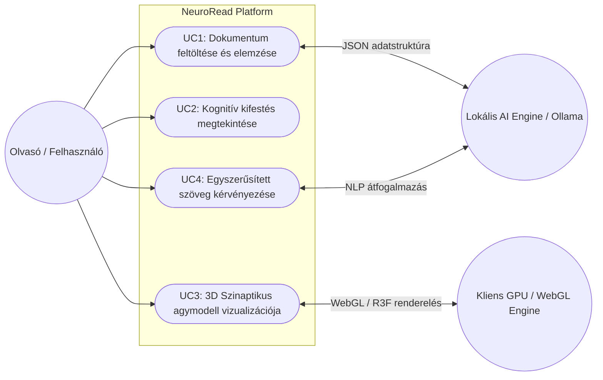
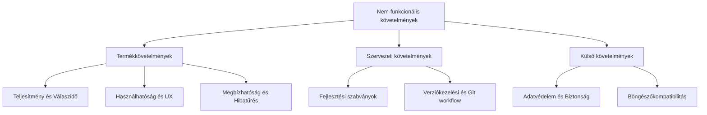
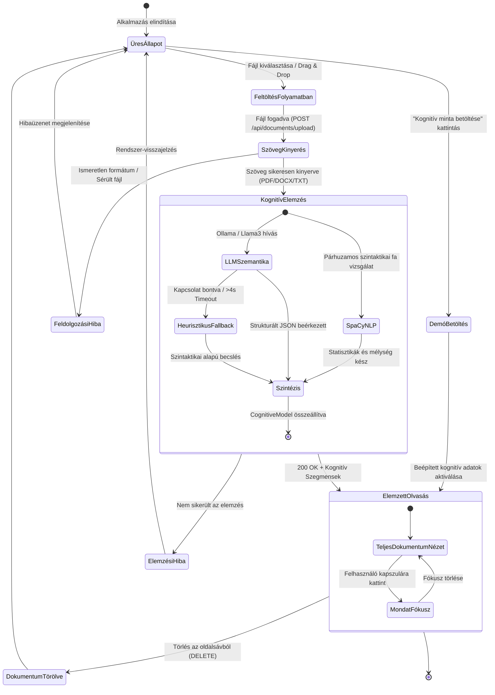
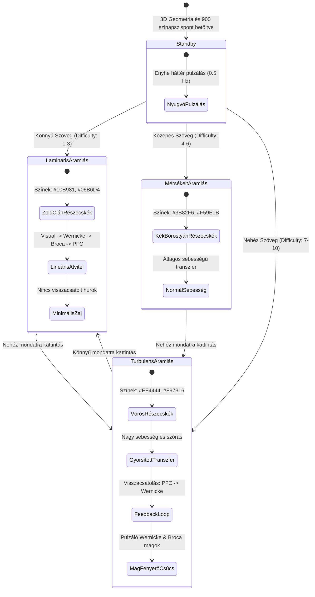
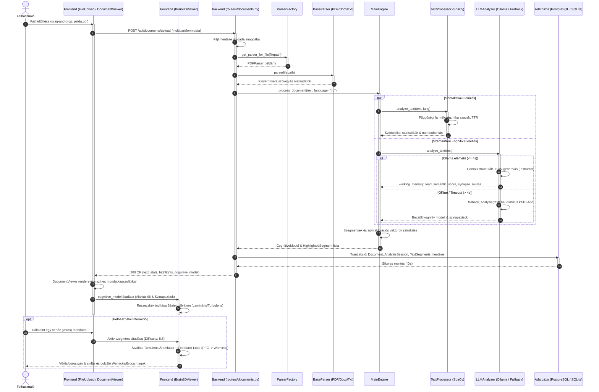

# 🧠 NeuroRead – Átfogó Rendszerdokumentáció és Fejlesztési Krónika

> **Kognitív Szövegelemző és 3D Agyi Információáramlást Vizualizáló Platform**  
 
 A tanulás effektivitása szempontjából kulcsfontosságú elem az idő. Nem mindegy, hogy mikor mit tanulunk, hiszen a nehezebb szövegekhez frissebb elme szükséges, míg a könnyebb szövegeket fáradtabban is meg tudjuk tanulni.
 A NeuroRead egy kognitív szövegelemző és oktatástámogató platform, amelynek célja a komplex, szakmai szövegek megértésének elősegítése a nehezebb szavak kijelölésével, a kognitív terhelés ábrázolásával. A rendszer többnyelvű (magyar, román, angol) természetes nyelvfeldolgozási (NLP) és mesterséges intelligencia (Ollama / Llama 3) algoritmusok segítségével elemzi a szövegek nehézségét, kognitív terhelését és szintaxisát, ábrázolja az agyi terhelést valamint ad egy javaslatot a szöveg leegyszerűsítésére.

 Célkitűzések
    - felhasználó segítése abban, hogy felmérje a tananyag nehézségét
    - kognitív terhelés ábrázolása
    - valós idejű 3D teljesítmény
    - nehezebb szövegrészek egyszerűsítése
    - a fontosabb kifejezések kijelölése nehézség szerint

Use-case diagramm

#Irodalomkutatás és Szakirodalmi Áttekintés (Literature Review)

    Alapvető definíciók és kognitív tudományos háttér
A NeuroRead platform tervezése két fő tudományterület — a kognitív pszichológia és a számításos nyelvészet (NLP) — metszéspontjában helyezkedik el. A rendszer elméleti alapját John Sweller Kognitív Terhelés Elmélete (Cognitive Load Theory, CLT) adja. A definíció szerint a kognitív terhelés az emberi munkamemória (working memory) által egy adott pillanatban feldolgozott információ mennyiségét jelenti. Összetett, többszörösen alárendelt mondatszerkezetek vagy ritka szakkifejezések olvasásakor az úgynevezett járulékos kognitív terhelés (extraneous cognitive load) megnövekszik, ami rontja a szövegértés hatékonyságát.

Neurolingvisztikai szempontból az olvasás és a szövegfeldolgozás több agyterület összehangolt működését igényli, amelyet a Dual-Stream (kettős feldolgozási) modell ír le. Míg az elsődleges látókéreg (Visual Cortex) a vizuális karakterek felismeréséért felel, addig a Wernicke-terület a szemantikai dekódolást (a szavak jelentésének megértését), a Broca-terület a szintaktikai struktúrák elemzését, a prefrontális kéreg (Prefrontal Cortex) pedig a munkamemória fenntartását és a komplex összefüggések integrálását végzi. A NeuroRead 3D szinaptikus vizualizációja ezen neurobiológiai folyamatok absztrakt leképezésére épül.

    Meglévő megoldások és azok korlátai
A szövegértést segítő és nyelvi elemző szoftverek piacán jelenleg számos eszköz érhető el, azonban ezek mindegyike jelentős korlátokkal rendelkezik a NeuroRead célkitűzéseihez képest:

- Klasszikus olvashatósági mutatók (pl. Flesch-Kincaid, Gunning Fog Index): Ezek az algoritmusok kizárólag felszíni statisztikai jellemzőkre (szótagszám, mondathossz) támaszkodnak. Korlátjuk, hogy nem képesek felismerni a mélyebb szemantikai összefüggéseket vagy a kontextusfüggő fogalmi nehézségeket.

- Felhőalapú generatív AI asszisztensek (pl. ChatGPT, Claude): Bár a nagy nyelvi modellek (LLM) kiválóan alkalmasak szövegek egyszerűsítésére és összefoglalására, használatuk komoly adatvédelmi kockázatot jelent. A bizalmas tudományos, jogi vagy vállalati dokumentumok külső, harmadik fél által üzemeltetett szerverekre történő feltöltése gyakran sérti az adatbiztonsági előírásokat.

- Statikus kiemelő és jegyzetelő eszközök: A hagyományos olvasótámogató szoftverek nem rendelkeznek dinamikus, valós idejű vizualizációs visszacsatolással, így nem segítik a felhasználót abban, hogy vizuálisan is átlássa a szöveg által kiváltott kognitív terhelés eloszlását.

A NeuroRead ezen korlátok kiküszöbölésére lokálisan futtatott nyílt forráskódú nyelvi modellt (Ollama / Llama 3) kombinál determinisztikus NLP elemzéssel (SpaCy) és valós idejű WebGL 3D vizualizációval, így egyszerre biztosít mély szemantikai elemzést, interaktív visszajelzést és teljes körű adatvédelmet.

    Hivatkozások 
Sweller, J. (1988). Cognitive load during problem solving: Effects on learning. Cognitive Science, 12(2), 257–285. 
Hickok, G., & Poeppel, D. (2007). The cortical organization of speech processing. Nature Reviews Neuroscience, 8(5), 393–402.
Kincaid, J. P., Fishburne Jr, R. P., Rogers, R. L., & Chissom, B. S. (1975). Derivation of new readability formulas (Automated Readability Index, Fog Count and Flesch Reading Ease Formula) for Navy enlisted personnel. Research Branch Report 8-75, Millington, TN: Naval Technical Training, U.S. Naval Air Station.

A NeuroRead platform nem-funkcionális követelményei három fő kategóriára oszlanak: termékkövetelményekre, szervezeti követelményekre és külső követelményekre.

A termékkövetelmények tekintetében a rendszernek magas teljesítménybeli és válaszidőbeli elvárásoknak kell megfelelnie:
  - a frontend 3D-s WebGL renderelésének folyamatos, akadásmentes 60 FPS képfrissítést kell biztosítania az agymodell forgatása és az animációk futása során
  - a lokális LLM alapú kognitív elemzés válaszideje nem haladhatja meg az 5-8 másodpercet bekezdésenként
  - Használhatóság szempontjából az alkalmazás sötét témájú, letisztult, modern neuro-tech vizuális stílust követ, ahol a 3D agymodell az egérmozgatással intuitívan forgatható, dönthető és nagyítható. 

A szervezeti követelmények meghatározzák a felhasznált technológiai stacket és a fejlesztési folyamatokat.
  - A backend architektúra Python 3.10+, FastAPI, Pydantic v2, Instructor és SpaCy komponensekre épül
  - A frontend Node.js, React 18, Vite, Tailwind CSS, Three.js és React Three Fiber technológiákat alkalmaz. 
  - A csapatszintű együttműködésre Githubot használtunk amely ágalapú Git workflow-ra épül (main, developer, feat/* ágakkal), a függőségeket pedig központilag kezelt verziózott fájlokban (requirements.txt és package.json) kell nyilvántartani. A feladatok menedzsekésére Kanban táblát használtunk, és hetente átbeszéltük hogy ki hol tart, és az alapján új feladatokat tettünk a táblára.

A külső követelmények a biztonságra, az adatvédelemre és a kompatibilitásra fókuszálnak. 
  - Mivel a szövegelemzés teljes egészében lokálisan futtatott nyílt forráskódú nyelvi modellen alapul, a felhasználók által feltöltött bizalmas dokumentumok nem kerülnek harmadik fél külső szervereire, garantálva a teljes adatvédelmet. 
  - A szerver semmilyen feltöltött dokumentumot nem tárol véglegesen. A feldolgozás után a fájlok csak ideiglenesen maradnak a memóriában/átmeneti tárolóban, majd egy automatikus törlési mechanizmus (Data Retention Cleanup) néhány napon belül véglegesen megsemmisíti őket.
  - Emellett a webes alkalmazás szabványos REST API kommunikációt használ, és teljes körű kompatibilitást biztosít a modern WebGL-képes böngészőkkel, mint a Google Chrome, Mozilla Firefox, Microsoft Edge és Safari.

#UML diagrammok

## 1. Komponens Diagram (Component Diagram)

A NeuroRead három fő rétegre tagolódik: 
  - **React + Three.js Frontend**
  - **FastAPI REST Backend**
  - **Kognitív AI Motor**. 
Ezek konténerizált környezetben vagy helyi fejlesztői környezetben működnek együtt.

```mermaid
flowchart TB
    subgraph FrontendApp["Frontend Réteg (React 19 + Three.js / R3F + Vite)"]
        UI_Shell["App.jsx (Alkalmazás héj & Navigáció)"]
        Auth_Comp["AuthModal & AuthContext (JWT kezelés)"]
        Doc_Side["DocumentSidebar.jsx (Dokumentumtár)"]
        Upload_Comp["FileUpload.jsx (Dropzone & Demó Betöltő)"]
        Doc_View["DocumentViewer.jsx (Olvasó Stúdió & Metrikák)"]
        Highlighter["TextHighlighter.jsx (Kognitív Kapszulák)"]
        
        subgraph Brain3D["Brain3DViewer Modul"]
            Canvas3D["Three.js R3F Canvas"]
            CortexMesh["Procedurális Agykéreg (Gyri & Sulci)"]
            SynapseCloud["900 Pontos Neurális Felhő"]
            CognitiveHubs["4 Kognitív Hub (Visual, Wernicke, Broca, PFC)"]
            FlowParticles["Bézier Információáramlás Részecskék"]
            HUD_Overlay["Telemetria HUD Overlay"]
        end
        
        UI_Shell --> Auth_Comp
        UI_Shell --> Doc_Side
        UI_Shell --> Upload_Comp
        UI_Shell --> Doc_View
        Doc_View --> Highlighter
        Doc_View --> Brain3D
        Canvas3D --> CortexMesh
        Canvas3D --> SynapseCloud
        Canvas3D --> CognitiveHubs
        Canvas3D --> FlowParticles
        Canvas3D --> HUD_Overlay
    end

    subgraph BackendAPI["Backend Szolgáltatás (FastAPI REST API)"]
        MainApp["main.py (FastAPI App & CORS)"]
        SecurityMod["core/security.py (JWT, Bcrypt)"]
        AuthRouter["routers/auth.py (Login, Register, Me)"]
        DocRouter["routers/documents.py (CRUD & Upload)"]
        
        subgraph ParserStrategy["Dokumentum-elemző Stratégiák (Strategy Pattern)"]
            Factory["parsers/factory.py (ParserFactory)"]
            PDFP["parsers/pdf_parser.py (PDFParser)"]
            DocxP["parsers/docx_parser.py (DocxParser)"]
            TxtP["parsers/txt_parser.py (TxtParser)"]
        end
        
        DBConn["database/connection.py (Engine & Session)"]
        
        MainApp --> AuthRouter
        MainApp --> DocRouter
        AuthRouter --> SecurityMod
        DocRouter --> Factory
        Factory --> PDFP
        Factory --> DocxP
        Factory --> TxtP
        AuthRouter --> DBConn
        DocRouter --> DBConn
    end

    subgraph AIEngine["Kognitív Elemző Motor (src/ai_engine)"]
        Orchestrator["main_engine.py (MainEngine Koordinátor)"]
        
        subgraph NLP_Pipeline["SpaCy Többnyelvű NLP"]
            NLP_Proc["nlp_processor.py (TextProcessor)"]
            HuModel["hu_core_news_lg (Magyar)"]
            EnModel["en_core_web_sm (Angol)"]
            RoModel["ro_core_news_lg (Román)"]
            SyntaxTree["Szintaktikai Fa Mélység & TTR"]
        end
        
        subgraph LLM_Analysis["Szemantikai Elemzés"]
            LLM_Proc["llm_analyzer.py (LLMAnalyzer)"]
            OllamaClient["Ollama / Llama3 (Instructor)"]
            HeuristicFallback["Heurisztikus Offline Fallback"]
        end
        
        CognitiveSchemas["schemas.py (Pydantic Adatmodellek)"]
        
        Orchestrator --> NLP_Proc
        Orchestrator --> LLM_Proc
        NLP_Proc --> HuModel
        NLP_Proc --> EnModel
        NLP_Proc --> RoModel
        NLP_Proc --> SyntaxTree
        LLM_Proc --> OllamaClient
        LLM_Proc -.->|Kapcsolati Hiba / Időtúllépés| HeuristicFallback
        Orchestrator --> CognitiveSchemas
    end

    subgraph Persistence["Adattárolási és Fájlréteg"]
        PG_DB[("PostgreSQL Adatbázis (Docker)")]
        SQLite_Fallback[("SQLite Fallback (neuroread.db)")]
        FileStore[("Helyi / Konténer Fájltár (uploads/)")]
    end

    %% Kapcsolatok a rétegek között
    Auth_Comp -.->|HTTP Bearer JWT| AuthRouter
    Upload_Comp -.->|multipart/form-data| DocRouter
    Doc_Side -.->|REST Lekérdezések| DocRouter
    DocRouter --> Orchestrator
    DocRouter --> FileStore
    DBConn --> PG_DB
    DBConn -.->|Fallback ha nincs PostgreSQL| SQLite_Fallback
```

## 2. Állapotdiagram (State Diagram)

A NeuroReadben két kulcsfontosságú állapotgép működik:
1. **Dokumentum-életciklus állapotgép:** A feltöltéstől a kognitív analízisen át a törlésig.
2. **3D Agyi Információáramlás állapotgép:** Az olvasási nehézség és felhasználói interakció függvényében váltakozó neurális módok.

### 2.1. Dokumentum és Elemzési Folyamat Állapotai

### 2.2. 3D Agyi Információáramlás Állapotai (Brain3DViewer Dynamics)

## 3. Szekvenciadiagram (Sequence Diagram)

Az alábbi szekvenciadiagram a dokumentum feltöltésének, kognitív többnyelvű elemzésének, a hibatűrő LLM feldolgozásnak és a 3D szinkronizált megjelenítésnek az időbeli lefolyását illusztrálja.

Funkcionalitás + Adatáramlás + Architektúra

flowchart TB
    User(("👤 Felhasználó"))

    subgraph Frontend["Frontend Réteg (React 19 + Three.js / R3F + Vite)"]
        UI["Cyber-Cognitive UI (App.jsx)"]
        Viewer["DocumentViewer & TextHighlighter"]
        Brain["Brain3DViewer (3D Információáramlás)"]
        Sidebar["DocumentSidebar & FileUpload"]
        AuthCtx["AuthContext & AxiosClient"]
    end

    subgraph Backend["Backend Szolgáltatások (FastAPI + SQLAlchemy)"]
        API["FastAPI REST API (main.py)"]
        RouterAuth["Auth Router (JWT / Bcrypt)"]
        RouterDocs["Documents Router (CRUD & Upload)"]
        Parsers["Document Parser Factory (Strategy Pattern)"]
        ORM["SQLAlchemy ORM (User, Document, Analysis)"]
    end

    subgraph AIEngine["Kognitív Elemző Motor (Python)"]
        ME["MainEngine (Koordinátor)"]
        NLP["SpaCy NLP Processor (HU, RO, EN)"]
        LLM["Ollama / Llama3 LLM Analyzer (Instructor)"]
        Fallback["Heuristic Cognitive Fallback"]
    end

    subgraph DataLayer["Adatbázis és Fájlrendszer"]
        DB[("PostgreSQL / SQLite Fallback")]
        Storage[("Helyi / Konténer Fájltároló (uploads/)")]
    end

    %% Felhasználói Interakciók
    User -->|1. Fájlt feltölt / Navigál| Sidebar
    User -->|2. Bejelentkezik / Vezérli| UI
    User -->|3. Olvassa a szöveget| Viewer
    User -.->|4. Látja a 3D vizualizációt| Brain

    %% Belső Frontend kapcsolatok
    UI --> AuthCtx
    Viewer --> Brain
    Sidebar --> UI

    %% Frontend-Backend Adatáramlás
    AuthCtx --> API
    API --> RouterAuth
    API --> RouterDocs

    %% Backend logika és Adatbázis
    RouterDocs --> Parsers
    RouterDocs --> ME
    RouterDocs --> ORM
    RouterAuth --> ORM
    ORM --> DB
    Parsers --> Storage

    %% AI feldolgozás
    ME --> NLP
    ME --> LLM
    LLM -.->|Offline esetén| Fallback

@router.post("/documents/upload", status_code=status.HTTP_201_CREATED, response_model=DocumentResponse)
async def upload_document(file: UploadFile = File(...), db: Session = Depends(get_db), current_user: Optional[User] = Depends(get_optional_current_user)):

	- ez egy POST kéréseket fogadó végpont az "/upload" útvonalon
	- ha a kérés sikeresen lefut, akkor automatikusan egy 201 CREATED státuszkóddal válaszol a szerver
	- file: egy beérkező fájlt kér, ami nélkül a felhasználó nem tudna semmit se feltölteni
	- db: szükség van az adatbázis kapcsolatra ahhoz, hogy a feltöltött dokumentum metaadatait el tudjuk menteni
	- current_user: az aktuálisan bejelentkezett felhasználó objektuma, vagy ha nincs bejelentkezve, akkor None, innen tudjuk meg azt, hogy hozzá kell-e kötni a dokumentumot egy felhasználói fiókhoz az adatbázisban, vagy vendégként fogjuk kezelni
	- ellenőrizzük, hogy a feltöltött fájlnak van-e neve, ha nincs, akkor 400 BAD REQUEST hibával fog visszatérni
	- eltároljuk a fájl kiterjesztését, majd megvizsgáljuk, hogy ez támogatott formátumú-e vagy sem, ha nem támogatott, akkor 400 BAD REQUEST hibát ad
	- generálunk egy biztonságos fájlnevet: a szóközöket lecseréljük, az elejéhez hozzáfűzzük a felhasználó id-ját vagy a "guest" szót, majd a fájlt lementjük
	- a szövegkinyeréshez meghívjuk a _read_document_content függvényen keresztül a ParserFactory függvényt, amely a fájl kiterjesztésének megfelelően olvassa be a fájlt
	- a kimentett szöveget átadjuk a _build_cognitive_model segédfüggvénynek, amely előállítja a kognitív modellt a szöveg komplexitása alapján
	- a kimentett szöveg alapján kigenerájuk a request_simplification függvény segítségével a szöveg egyszerűsített magyar verzióját
	- ha egy bejelentkezett felhasználó töltötte fel a dokumentumot, akkor a dokumentum adatait (dokumentum neve, kiterjesztése, mérete, elérési helye és a felhasználó egyedi azonosítója) feltöltjük az adatbázisba a megfelelő felhasználóhoz
	- a függvény a DocumentResponse pydantic objektumot adja vissza, amelyben megtalálható a dokumentum egyedi azonosítója, az eredeti fájlnév, a fájl mérete kilobájtban, a fájl kiterjesztése, a fájlból kinyert teljes szöveg, a generált kognitív elemzési adatok, illetve a generált egyszerűsített szöveg és kulcsszavak

@router.post("/documents/{document_id}/analyze")
async def analyze_document(document_id: str, db: Session = Depends(get_db), current_user: Optional[User] = Depends(get_optional_current_user)):

	- ez egy POST kéréseket fogadó végpont a "/{document_id}/analyze" útvonalon
	- document_id: szükségünk van a dokumentum egyéni azonosítójára, hogy meg tudjuk keresni az adatbázisban
	- db: szükség van az adatbázis kapcsolatra ahhoz, hogy a megvizsgált dokumentum metaadatait el tudjuk menteni
	- current_user: az aktuálisan bejelentkezett felhasználó objektuma, vagy ha senki nincs bejelentkezve akkor None, innen tudjuk meg azt, hogy hozzá kell-e kötni a dokumentumot egy felhasználói fiókhoz az adatbázisban
	- lekérjük a megfelelő dokumentumot, amiből a _read_document_content függvényen keresztül elért ParserFactory függvény segítségével kinyerjük a szöveget a kiterjesztésnek megfelelően
	- a kinyert szöveget átadjuk a run_full_analysis függvénynek, amely lefuttatja a kognitív elemzést (nehéz, kiemelendő szavak meghatározása), ezeket az adatokat pedig egy cogitive_model változóba mentjük ki, ha az elemzés valami okból kifolyólag nem futtatható, meghívjuk a _build_cognitive_model segédfüggvényt, amely előállítja a kognitív modellt
	- következőnek előállítjuk az egyszerűsített szöveget a request_simpliication függvény segítségével
	- a függvény visszatéríti a dokumentum egyedi azonosítóját, a kognitív modellt, illetve az egyszerűsített szöveget

### Adatfeldolgozási folyamat (Upload -> Analysis -> 3D Render):
1. **Fájlfeltöltés:** A felhasználó feltölt egy fájlt (`POST /api/documents/upload`).
2. **Szövegkinyerés:** A `ParserFactory` azonosítja a MIME-típust, és delegálja a feladatot a megfelelő parsernek (`PDFParser`, `DocxParser`, `TxtParser`).
3. **Kognitív Szintézis:** A `MainEngine` párhuzamosan elindítja a `SpaCy` szintaktikai ellenőrzést és az `LLM` szemantikai vizsgálatát.
4. **Neurális Modell Generálás:** A backend összeállítja a mondatonkénti kognitív skálát és a `CognitiveModel` agyi szinapszishálózatát.
5. **3D Vizualizáció:** A frontend fogadja az adatokat; a `DocumentViewer` kiemeli a nehéz mondatokat, a `Brain3DViewer` pedig elindítja a részecskék áramlását a kognitív pályákon

Összefoglaló fejezet

A NeuroRead projekt fejlesztése során sikeresen megvalósult egy modern webes szövegelemző platform, amely a mesterséges intelligencia és a 3D-s adatvizualizáció ötvözésével segíti a komplexebb szövegek megértését, segít a tanulás beosztásában a kognitív terhelés ábrázolásával. 
A fejlesztés során a kitűzött célok hiánytalanul teljesültek: a természetes nyelvfeldolgozó modul és a lokális nyelvi modell(Ollama / Llama 3) segítségével megvalósult a szövegek szintaktikai elemzése, a fontos kifejezések kiemelése és gombnyomásra a szöveg egyszerűsítése, míg a frontend oldalon egy React Three Fiber alapú, 60 FPS sebességgel futó interaktív 3D agymodell jeleníti meg az agyterületek közötti szinaptikus információáramlást.
