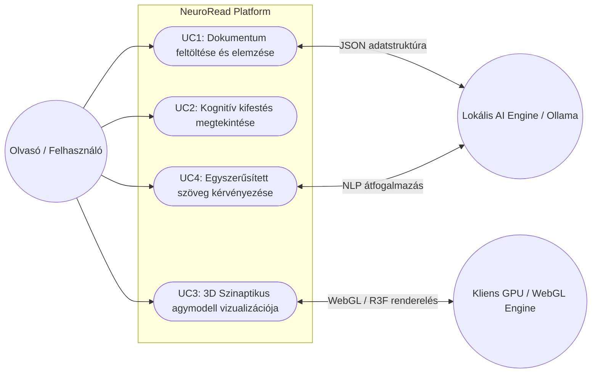
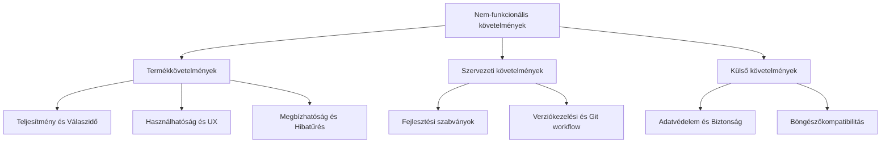
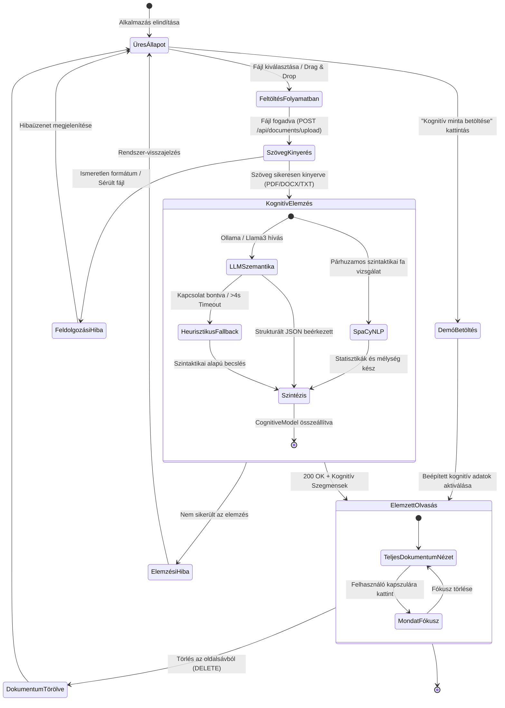
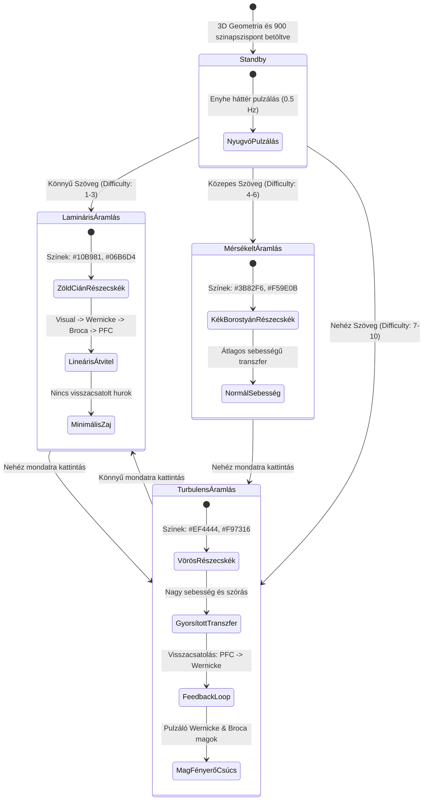
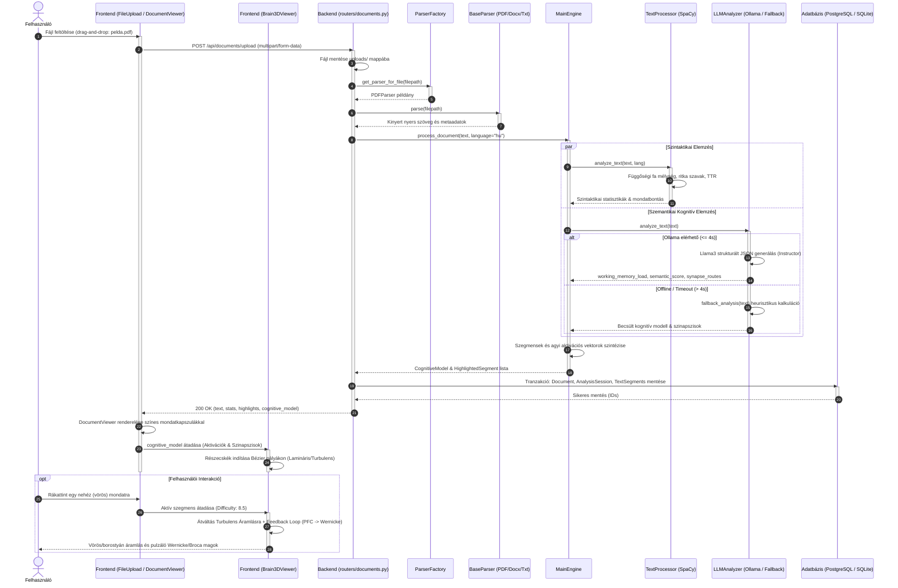
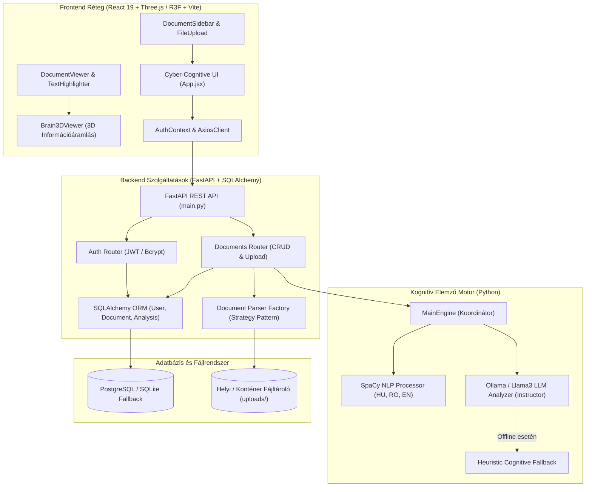

# 🧠 NeuroRead – Átfogó Rendszerdokumentáció és Fejlesztési Krónika

> **Kognitív Szövegelemző és 3D Agyi Információáramlást Vizualizáló Platform**  
 
 A NeuroRead egy kognitív szövegelemző és oktatástámogató platform, amelynek célja a komplex, szakmai szövegek megértésének elősegítése. A rendszer többnyelvű (magyar, román, angol) természetes nyelvfeldolgozási (NLP) és mesterséges intelligencia (Ollama / Llama 3) algoritmusok segítségével elemzi a szövegek nehézségét, kognitív terhelését és szintaxisát, ábrázolja az agyi terhelést valamint ad egy javaslatot a szöveg leegyszerűsítésére.

Use-case diagramm


A NeuroRead platform nem-funkcionális követelményei három fő kategóriára oszlanak: termékkövetelményekre, szervezeti követelményekre és külső követelményekre.


A termékkövetelmények tekintetében a rendszernek magas teljesítménybeli és válaszidőbeli elvárásoknak kell megfelelnie:
  - a frontend 3D-s WebGL renderelésének folyamatos, akadásmentes 60 FPS képfrissítést kell biztosítania az agymodell forgatása és az animációk futása során
  - a lokális LLM alapú kognitív elemzés válaszideje nem haladhatja meg az 5-8 másodpercet bekezdésenként
  - Használhatóság szempontjából az alkalmazás sötét témájú, letisztult, modern neuro-tech vizuális stílust követ, ahol a 3D agymodell az egérmozgatással intuitívan forgatható, dönthető és nagyítható. 

A szervezeti követelmények meghatározzák a felhasznált technológiai stacket és a fejlesztési folyamatokat.
  - A backend architektúra Python 3.10+, FastAPI, Pydantic v2, Instructor és SpaCy komponensekre épül
  - A frontend Node.js, React 18, Vite, Tailwind CSS, Three.js és React Three Fiber technológiákat alkalmaz. 
  - A csapatszintű együttműködésre Githubot használtunk amely ágalapú Git workflow-ra épül (main, developer, feat/* ágakkal), a függőségeket pedig központilag kezelt verziózott fájlokban (requirements.txt és package.json) kell nyilvántartani. A feladatok menedzsekésére Kanban táblát használtunk, és hetente átbeszéltük hogy ki hol tart, és az alapján új feladatokat tettünk a táblára.

A külső követelmények a biztonságra, az adatvédelemre és a kompatibilitásra fókuszálnak. 
  - Mivel a szövegelemzés teljes egészében lokálisan futtatott nyílt forráskódú nyelvi modellen alapul, a felhasználók által feltöltött bizalmas dokumentumok nem kerülnek harmadik fél külső szervereire, garantálva a teljes adatvédelmet. 
  - A szerver semmilyen feltöltött dokumentumot nem tárol véglegesen. A feldolgozás után a fájlok csak ideiglenesen maradnak a memóriában/átmeneti tárolóban, majd egy automatikus törlési mechanizmus (Data Retention Cleanup) néhány napon belül véglegesen megsemmisíti őket.
  - Emellett a webes alkalmazás szabványos REST API kommunikációt használ, és teljes körű kompatibilitást biztosít a modern WebGL-képes böngészőkkel, mint a Google Chrome, Mozilla Firefox, Microsoft Edge és Safari.

UML diagrammok

## 1. Komponens Diagram (Component Diagram)

A NeuroRead három fő rétegre tagolódik: 
  - **React + Three.js Frontend**
  - **FastAPI REST Backend**
  - **Kognitív AI Motor**. 
Ezek konténerizált környezetben vagy helyi fejlesztői környezetben működnek együtt.

```mermaid
flowchart TB
    subgraph FrontendApp["Frontend Réteg (React 19 + Three.js / R3F + Vite)"]
        UI_Shell["App.jsx (Alkalmazás héj & Navigáció)"]
        Auth_Comp["AuthModal & AuthContext (JWT kezelés)"]
        Doc_Side["DocumentSidebar.jsx (Dokumentumtár)"]
        Upload_Comp["FileUpload.jsx (Dropzone & Demó Betöltő)"]
        Doc_View["DocumentViewer.jsx (Olvasó Stúdió & Metrikák)"]
        Highlighter["TextHighlighter.jsx (Kognitív Kapszulák)"]
        
        subgraph Brain3D["Brain3DViewer Modul"]
            Canvas3D["Three.js R3F Canvas"]
            CortexMesh["Procedurális Agykéreg (Gyri & Sulci)"]
            SynapseCloud["900 Pontos Neurális Felhő"]
            CognitiveHubs["4 Kognitív Hub (Visual, Wernicke, Broca, PFC)"]
            FlowParticles["Bézier Információáramlás Részecskék"]
            HUD_Overlay["Telemetria HUD Overlay"]
        end
        
        UI_Shell --> Auth_Comp
        UI_Shell --> Doc_Side
        UI_Shell --> Upload_Comp
        UI_Shell --> Doc_View
        Doc_View --> Highlighter
        Doc_View --> Brain3D
        Canvas3D --> CortexMesh
        Canvas3D --> SynapseCloud
        Canvas3D --> CognitiveHubs
        Canvas3D --> FlowParticles
        Canvas3D --> HUD_Overlay
    end

    subgraph BackendAPI["Backend Szolgáltatás (FastAPI REST API)"]
        MainApp["main.py (FastAPI App & CORS)"]
        SecurityMod["core/security.py (JWT, Bcrypt)"]
        AuthRouter["routers/auth.py (Login, Register, Me)"]
        DocRouter["routers/documents.py (CRUD & Upload)"]
        
        subgraph ParserStrategy["Dokumentum-elemző Stratégiák (Strategy Pattern)"]
            Factory["parsers/factory.py (ParserFactory)"]
            PDFP["parsers/pdf_parser.py (PDFParser)"]
            DocxP["parsers/docx_parser.py (DocxParser)"]
            TxtP["parsers/txt_parser.py (TxtParser)"]
        end
        
        DBConn["database/connection.py (Engine & Session)"]
        
        MainApp --> AuthRouter
        MainApp --> DocRouter
        AuthRouter --> SecurityMod
        DocRouter --> Factory
        Factory --> PDFP
        Factory --> DocxP
        Factory --> TxtP
        AuthRouter --> DBConn
        DocRouter --> DBConn
    end

    subgraph AIEngine["Kognitív Elemző Motor (src/ai_engine)"]
        Orchestrator["main_engine.py (MainEngine Koordinátor)"]
        
        subgraph NLP_Pipeline["SpaCy Többnyelvű NLP"]
            NLP_Proc["nlp_processor.py (TextProcessor)"]
            HuModel["hu_core_news_lg (Magyar)"]
            EnModel["en_core_web_sm (Angol)"]
            RoModel["ro_core_news_lg (Román)"]
            SyntaxTree["Szintaktikai Fa Mélység & TTR"]
        end
        
        subgraph LLM_Analysis["Szemantikai Elemzés"]
            LLM_Proc["llm_analyzer.py (LLMAnalyzer)"]
            OllamaClient["Ollama / Llama3 (Instructor)"]
            HeuristicFallback["Heurisztikus Offline Fallback"]
        end
        
        CognitiveSchemas["schemas.py (Pydantic Adatmodellek)"]
        
        Orchestrator --> NLP_Proc
        Orchestrator --> LLM_Proc
        NLP_Proc --> HuModel
        NLP_Proc --> EnModel
        NLP_Proc --> RoModel
        NLP_Proc --> SyntaxTree
        LLM_Proc --> OllamaClient
        LLM_Proc -.->|Kapcsolati Hiba / Időtúllépés| HeuristicFallback
        Orchestrator --> CognitiveSchemas
    end

    subgraph Persistence["Adattárolási és Fájlréteg"]
        PG_DB[("PostgreSQL Adatbázis (Docker)")]
        SQLite_Fallback[("SQLite Fallback (neuroread.db)")]
        FileStore[("Helyi / Konténer Fájltár (uploads/)")]
    end

    %% Kapcsolatok a rétegek között
    Auth_Comp -.->|HTTP Bearer JWT| AuthRouter
    Upload_Comp -.->|multipart/form-data| DocRouter
    Doc_Side -.->|REST Lekérdezések| DocRouter
    DocRouter --> Orchestrator
    DocRouter --> FileStore
    DBConn --> PG_DB
    DBConn -.->|Fallback ha nincs PostgreSQL| SQLite_Fallback
```


## 2. Állapotdiagram (State Diagram)

A NeuroReadben két kulcsfontosságú állapotgép működik:
1. **Dokumentum-életciklus állapotgép:** A feltöltéstől a kognitív analízisen át a törlésig.
2. **3D Agyi Információáramlás állapotgép:** Az olvasási nehézség és felhasználói interakció függvényében váltakozó neurális módok.

### 2.1. Dokumentum és Elemzési Folyamat Állapotai



### 2.2. 3D Agyi Információáramlás Állapotai (Brain3DViewer Dynamics)


## 3. Szekvenciadiagram (Sequence Diagram)

Az alábbi szekvenciadiagram a dokumentum feltöltésének, kognitív többnyelvű elemzésének, a hibatűrő LLM feldolgozásnak és a 3D szinkronizált megjelenítésnek az időbeli lefolyását illusztrálja.




mikor mi tortenik funkcionalitas 
architekturan az ember, frontend, internet , ollama, adatbazis , backend, mi van a felhoben mi a backendben - 


ui leirasa az adatflow szempontbol - pdfet feltoltik, onnan hova megy mi lesz belemenni hogy mit miert valasztottunk pl miert Reactet 

backend - reszletezni a requesteket es respondokat 
ket harom API-t kivalasztani es azokra bemutatni a request rspons pl amikor jon az agy bemeno parameterek , peldat adni vagy abrat rajzolni hogy mi jon be, es hogyan jon ki az API -bol (dobozkak nyilakkal)

adatmodellekrol beszelni  + adatbazis + mi az adatmodell ORM
adatbazis diagramm tablak + keyek / entitas diagramm  user osszekotve a historyval

teszteles mit hoszan teszteltuk 

helm chart - 


.


## 3. Rendszerarchitektúra és Adatfolyam

A NeuroRead egy modern, szétválasztott (decoupled) háromrétegű kliens-szerver architektúrát alkalmaz:



### Adatfeldolgozási folyamat (Upload -> Analysis -> 3D Render):
1. **Fájlfeltöltés:** A felhasználó feltölt egy fájlt (`POST /api/documents/upload`).
2. **Szövegkinyerés:** A `ParserFactory` azonosítja a MIME-típust, és delegálja a feladatot a megfelelő parsernek (`PDFParser`, `DocxParser`, `TxtParser`).
3. **Kognitív Szintézis:** A `MainEngine` párhuzamosan elindítja a `SpaCy` szintaktikai ellenőrzést és az `LLM` szemantikai vizsgálatát.
4. **Neurális Modell Generálás:** A backend összeállítja a mondatonkénti kognitív skálát és a `CognitiveModel` agyi szinapszishálózatát.
5. **3D Vizualizáció:** A frontend fogadja az adatokat; a `DocumentViewer` kiemeli a nehéz mondatokat, a `Brain3DViewer` pedig elindítja a részecskék áramlását a kognitív pályákon.

---

## 4. Részletes Modulbemutatás

### 4.1. Mesterséges Intelligencia és Kognitív Motor (`src/ai_engine`)

A modul felelős a szöveg mély strukturális és gondolati elemzéséért.

- **`nlp_processor.py` (TextProcessor):**
  - Többnyelvű SpaCy támogatás: magyar (`hu_core_news_lg`), román (`ro_core_news_lg`), angol (`en_core_web_sm`).
  - Nyelvfelismerés és lusta betöltés (lazy loading): a nagy modellek csak igény esetén töltődnek be a memóriába.
  - Szintaktikai mélységmérés: a függőségi fák (dependency trees) mélységéből számítja ki a feldolgozási nehézséget.
  - Olvashatósági statisztikák (`analyze_stats`): szó- és mondatszám, lexikális diverzitás (TTR – Type-Token Ratio), átlagos mondathossz.
- **`llm_analyzer.py` (LLMAnalyzer):**
  - Helyi mesterséges intelligencia (Ollama, modell: `llama3:8b` vagy tetszőleges helyi modell) integrációja az **Instructor** könyvtárral.
  - Kinyeri a munkamemória-terhelést (`working_memory_load`: 0.0 - 1.0) és az absztrakt komplexitást (`semantic_complexity_score`: 1 - 10).
  - Robusztus hibatűrés: ha a helyi LLM szerver nem fut vagy időtúllépés történik (4 másodperc), azonnal észrevétlenül átvált egy heurisztikus nyelvi elemzőre, így a rendszer sosem áll le.
- **`main_engine.py` (MainEngine):**
  - Összefűzi az NLP szegmenseket és az LLM jelöléseket.
  - Generálja az agyi aktivációkat (`BrainActivation`) és szinaptikus pályákat (`SynapseFlow`).

---

### 4.2. Backend REST Szolgáltatások (`src/backend`)

A backend egy aszinkron **FastAPI** webes keretrendszer, amely tiszta, skálázható architektúrát biztosít.

- **`parsers/` Csomag (Strategy Pattern):**
  - `base.py`: Absztrakt `BaseParser` interfész `parse(file_path)` metódussal.
  - `pdf_parser.py`: PyMuPDF / pdfplumber alapú szöveg- és metaadat-kivonatolás.
  - `docx_parser.py`: `python-docx` alapú bekezdés- és táblázatfeldolgozás.
  - `txt_parser.py`: Többkódolású (UTF-8, ISO-8859-2, Windows-1250) robusztus szövegolvasó.
  - `factory.py`: MIME-típus és kiterjesztés alapján automatikus parser-kiosztás.
- **`core/security.py` & `routers/auth.py`:**
  - Jelszóhashelés `passlib` és `bcrypt` segítségével.
  - Aszimmetrikus / szimmetrikus JWT token generálás lejárati idővel (OAuth2 Bearer).
  - `get_optional_current_user`: Támogatja a regisztráció nélküli azonnali tesztelést (Guest Mode), miközben a bejelentkezett felhasználók fájljait privátként perzisztálja.
- **`database/connection.py`:**
  - PostgreSQL adatbázis-kapcsolat éles üzemben.
  - Automatikus fallback **SQLite** helyi adatbázisra (`neuroread.db`), ha a PostgreSQL szerver nem elérhető.

---

### 4.3. Modern Cyber-Cognitive Frontend (`src/frontend`)

A felhasználói felület **React 19** és **Vite** alapú:
- **`App.jsx`:** Központi vezérlőállomás navigációs sávval, interaktív bemutató résszel, munkamenet-kezeléssel és állapotszinkronizációval.
- **`DocumentViewer.jsx` & `TextHighlighter.jsx`:**
  - Kétpaneles elrendezés: a bal oldalon a vizsgált dokumentum, jobb oldalon a valós idejű 3D agymodell.
  - Mondatszintű kiemelések: interaktív kapszulák (pill marks), amelyekre kattintva az agymodell az adott mondat kognitív állapotára vált.
  - Metrikus sáv: szószám, becsült olvasási idő, átlagos kognitív pontszám és színskála-magyarázat.
- **`FileUpload.jsx`:** Drag-and-drop digitális szkenner stílusú feltöltőzóna, amely tartalmaz egy **beépített kognitív demószöveg-betöltőt** is, így a rendszer azonnal kipróbálható fájlfeltöltés nélkül is.
- **`DocumentSidebar.jsx`:** Keresővel és típusikonokkal ellátott oldalsáv az elemzett dokumentumok közötti gyors váltáshoz.
- **`AuthModal.jsx`:** Glassmorphic előugró ablak bejelentkezéshez és regisztrációhoz.

---

### 4.4. 3D Interaktív Agy és Információáramlás (`Brain3DViewer`)

A rendszer leglátványosabb és legfontosabb komponense a `Brain3DViewer.jsx`, amely **Three.js** és **React Three Fiber (R3F)** technológiát használ.

#### A 3D Modell Felépítése:
1. **Procedurális Agykéreg (Hemispheres):**
   - Két diszkrét félteke parametrikus elhelyezéssel.
   - Szinuszos és koszinuszos perturbációs háló, amely a valódi agykéreg barázdáit (sulci) és tekervényeit (gyri) mintázza.
   - Különálló kisagy (Cerebellum) és agytörzs (Brainstem) geometria.
2. **Neurális Pontfelhő (Point Cloud):**
   - 900 lebegő szinaptikus pont, amelyek lélegző animációval pulzálnak.
3. **Kognitív Központok (Funkcionális Hubok):**
   - **Vizuális kéreg (Visual Cortex):** Hátul, a tarkólebenyben (`z: -2.3`). A szöveg beérkezési kapuja.
   - **Wernicke-terület:** Bal halántéklebeny (`x: -1.7, y: 0.1, z: 0.2`). Szemantikai értelmezés és fogalmi dekódolás.
   - **Broca-terület:** Bal homloklebeny (`x: -1.4, y: 0.7, z: 1.2`). Nyelvtani és szintaktikai feldolgozás.
   - **Prefrontális kéreg (Prefrontal Cortex):** Elöl, a homloklebeny csúcsán (`z: 2.3`). Munkamemória, döntéshozatal, komplex asszociáció.

#### Információáramlás Szimuláció (Information Flow Dynamics):
Az információ nem statikus vonalakon, hanem **harmadfokú Bézier-görbéken (Cubic Bézier Curves)** áramló részecskék formájában terjed a funkcionális központok között:

```
[Visual Cortex] ---> [Wernicke-terület] ---> [Broca-terület] ---> [Prefrontal Cortex]
                             ^                                           |
                             |----------- (Feedback Loop) ---------------|
```

- **Könnyű Szöveg Mód (Easy / Lamináris Áramlás):**
  - **Színek:** Smaragdzöld és ciánkék (`#10b981`, `#06b6d4`).
  - **Dinamika:** Nyugodt, egyenletes, lineáris sebesség, alacsony részecskeszórás.
  - **Jelentése:** A szöveg könnyen értelmezhető, a munkamemória nincs leterhelve, nincsenek visszakérdezési hurkok.
- **Nehéz Szöveg Mód (Hard / Turbulens Áramlás):**
  - **Színek:** Pulzáló borostyánsárga, narancs és élénk kognitív vörös (`#f59e0b`, `#ef4444`).
  - **Dinamika:** Nagy sebességű részecskék, megnövelt szórás, pulzáló intenzitású magok.
  - **Feedback Loop (Visszacsatolás):** Aktív hibajavító és újrakódoló áramlás a Prefrontális kéregből vissza a Wernicke-területre, jelezve, hogy az agy kénytelen újraértelmezni a nehéz mondatrészeket.
- **Irányító HUD Panel:**
  - A felhasználó manuálisan is kapcsolhat a módok között (Automata / Könnyű / Nehéz), és leolvashatja a pillanatnyi agyi aktivitási frekvenciát és az aktív szinapszisok számát.

---

## 5. Tudományos Háttér: Kognitív Terhelés és Neurális Dinamika

A NeuroRead kognitív modellje **John Sweller Kognitív Terhelés Elméletére (Cognitive Load Theory - CLT)** és a modern pszicholingvisztika eredményeire támaszkodik:

1. **Belső Kognitív Terhelés (Intrinsic Load):**
   - A tananyag, illetve a szöveg témájának inherens nehézsége (fogalmi sűrűség, absztrakció).
   - Ezt a NeuroReadben az LLM szemantikai komplexitás pontszáma (`semantic_complexity_score`: 1–10) méri.
2. **Járulékos Kognitív Terhelés (Extraneous Load):**
   - A rosszul felépített mondatszerkezet, a feleslegesen bonyolult grammatika, a passzív szerkezetek és a túlzott függőségi fanagyság által okozott terhelés.
   - Ezt a SpaCy szintaktikai fa mélysége és a mondathossz alapján számítjuk ki.
3. **Értelmező Kognitív Terhelés (Germane Load):**
   - Az új információk meglévő tudássémákba való beépítése.
   - Az agymodellben ez a Wernicke-terület és a Prefrontális kéreg közötti szinaptikus aktivitásként jelenik meg.

### Alkalmazott Kognitív és Olvashatósági Mutatók:
- **Szintaktikai Komplexitási Index:** A SpaCy mondatelemző fa maximális mélysége és az alárendelt tagmondatok aránya.
- **Lexikális Nehézség (Lexical Density):** Ritka szavak aránya a szótári gyakorisági listákhoz képest.
- **Flesch Reading Ease & Flesch-Kincaid Grade Level:** Szótagszám és mondathossz alapú klasszikus skálák.

---

## 6. API Végpontok és Kommunikációs Szerződések

A FastAPI backend az alábbi strukturált REST végpontokat biztosítja:

### 6.1. Hitelesítés (`/api/auth`)
- `POST /api/auth/register`
  - Bemenet: `UserCreate` (`email`, `username`, `password`)
  - Kimenet: `UserResponse` (`id`, `email`, `username`, `created_at`)
- `POST /api/auth/login`
  - Bemenet: `OAuth2PasswordRequestForm` (`username`, `password`)
  - Kimenet: `Token` (`access_token`, `token_type: bearer`)
- `GET /api/auth/me`
  - Fejléc: `Authorization: Bearer <token>`
  - Kimenet: Az aktuális bejelentkezett felhasználó adatai.

### 6.2. Dokumentumkezelés és Elemzés (`/api/documents`)
- `POST /api/documents/upload`
  - Bemenet: `multipart/form-data` (`file: UploadFile`)
  - Működés: Fájl mentése, parser kiválasztása, szövegkinyerés, kognitív analízis lefutása.
  - Kimenet: `DocumentUploadResponse` (feldolgozott szöveg, statisztikák, kognitív kiemelések, `cognitive_model`).
- `GET /api/documents/`
  - Kimenet: A felhasználó (vagy vendég) korábban feltöltött dokumentumainak listája.
- `GET /api/documents/{document_id}`
  - Kimenet: Egy adott dokumentum részletes adatai, korábbi elemzési eredményei.
- `DELETE /api/documents/{document_id}`
  - Kimenet: Sikeres törlés visszajelzése.
- `POST /api/documents/{document_id}/analyze`
  - Működés: Létező dokumentum ismételt elemzése frissített paraméterekkel.

### 6.3. Közvetlen Kognitív MI Végpontok (`/api/ai`)
- `POST /api/ai/analyze-text`
  - Bemenet: Nyers szöveg és nyelv megjelölése (`hu`, `en`, `ro`).
  - Kimenet: Mondatonkénti kognitív súlyozás és kiemelési tartományok.
- `POST /api/ai/cognitive-model`
  - Kimenet: A 3D agyhoz szükséges szinapszispontok és aktivációs vektorok.

---

## 7. Telepítési, Konfigurációs és Futtatási Útmutató

A NeuroRead futtatható lokális fejlesztői környezetben vagy Docker konténerekben.

### 7.1. Rendszerkövetelmények
- **Operációs Rendszer:** Windows 10/11, macOS, vagy Ubuntu 20.04+
- **Python:** 3.10, 3.11 vagy 3.13
- **Node.js:** v18.0.0 vagy újabb (npm v9+)
- **Docker & Docker Compose:** (Opcionális, konténeres futtatáshoz)
- **Ollama:** (Opcionális, helyi Llama3 LLM gyorsításhoz)

---

### 7.2. Helyi Fejlesztői Környezet Beállítása (Local Setup)

#### 1. Lépés: Repository klónozása
```bash
git clone https://github.com/PitoPanna/NeuroRead.git
cd NeuroRead
```

#### 2. Lépés: Python virtuális környezet és függőségek
```bash
# Virtuális környezet létrehozása és aktiválása (Windows PowerShell)
python -m venv .venv
.\.venv\Scripts\Activate.ps1


*Dokumentáció lezárva: 2026. október 20.*  


