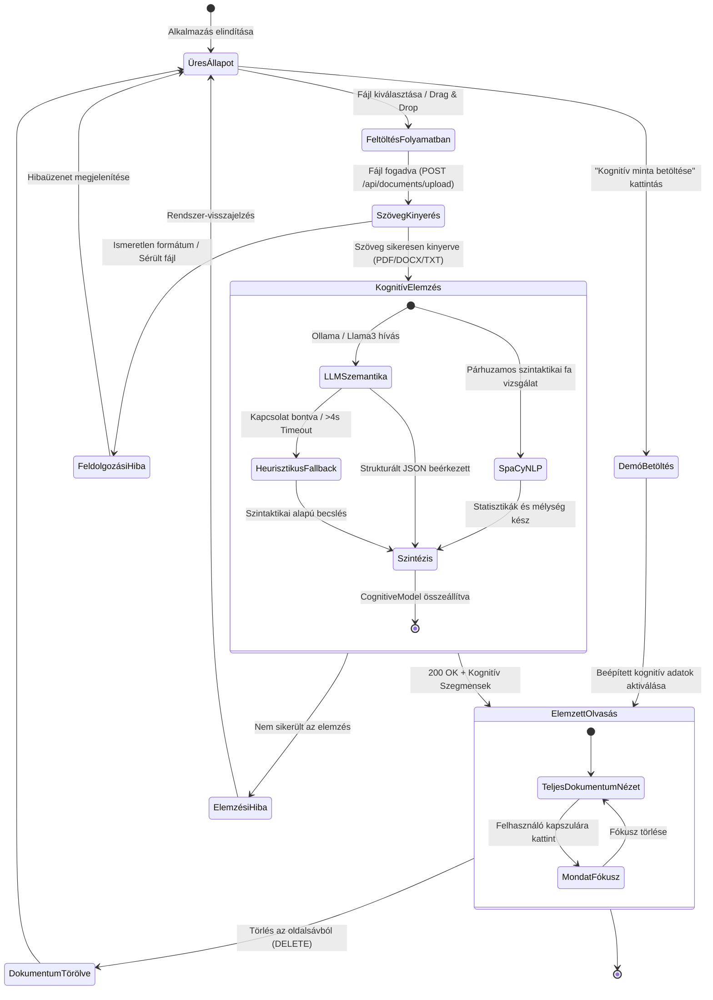
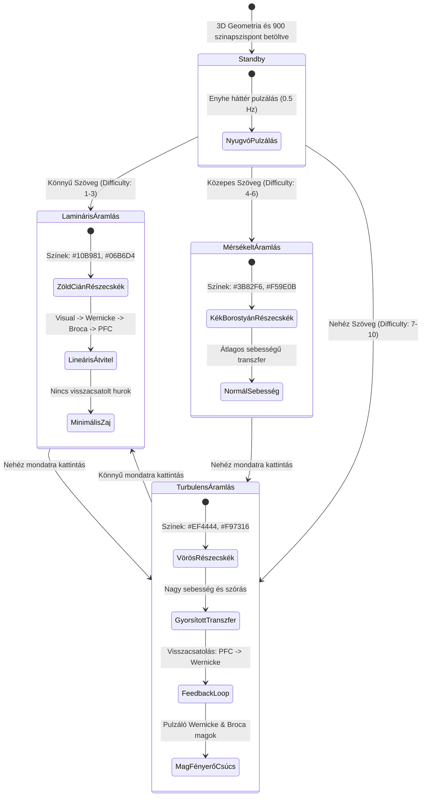
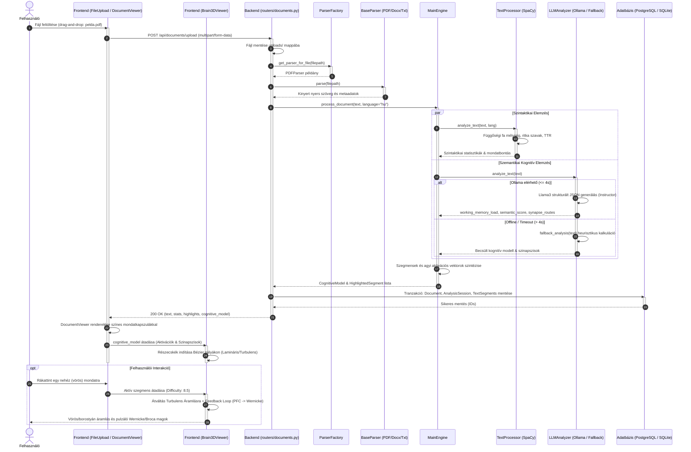
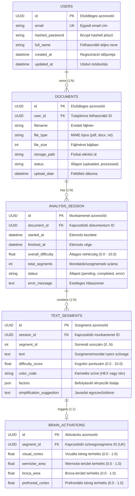
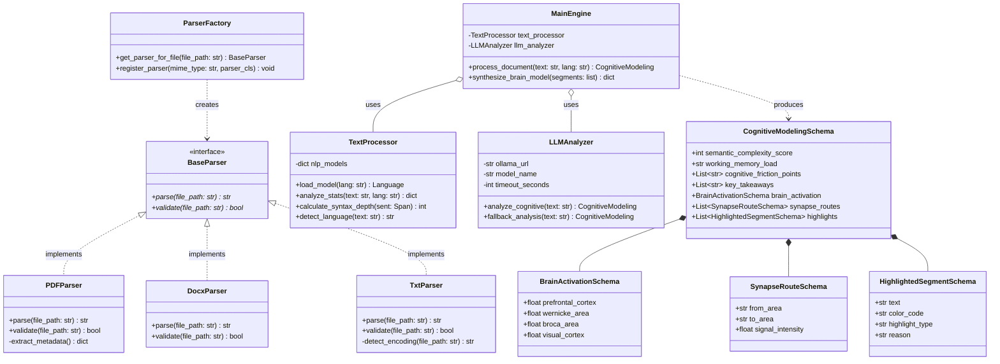

# 📐 NeuroRead – Rendszertervezési és Dokumentációs Ábrák

> **Architekturális diagramgyűjtemény a NeuroRead kognitív szövegelemző és 3D agy-vizualizációs platformhoz.**  
> Ez a dokumentum tartalmazza a szoftverrendszer formális UML és Mermaid diagramjait: **Komponens Diagram**, **Állapotdiagram**, **Szekvenciadiagram**, valamint **Adatmodell és Osztálystruktúra**.

---

## 📑 Tartalomjegyzék
1. [Komponens Diagram (Component Diagram)](#1-komponens-diagram-component-diagram)
2. [Állapotdiagram (State Diagram)](#2-állapotdiagram-state-diagram)
3. [Szekvenciadiagram (Sequence Diagram)](#3-szekvenciadiagram-sequence-diagram)
4. [Adatmodell és Entitás-Kapcsolat Diagram (ER Diagram)](#4-adatmodell-és-entitás-kapcsolat-diagram-er-diagram)
5. [Osztálystruktúra és Tervezési Minták (Class Diagram)](#5-osztálystruktúra-és-tervezési-minták-class-diagram)

---

## 1. Komponens Diagram (Component Diagram)

A NeuroRead három fő rétegre tagolódik: a **React + Three.js Frontend**, a **FastAPI REST Backend**, valamint a **Kognitív AI Motor**. Ezek konténerizált környezetben vagy helyi fejlesztői környezetben működnek együtt.

```mermaid
flowchart TB
    subgraph FrontendApp["Frontend Réteg (React 19 + Three.js / R3F + Vite)"]
        UI_Shell["App.jsx (Alkalmazás héj & Navigáció)"]
        Auth_Comp["AuthModal & AuthContext (JWT kezelés)"]
        Doc_Side["DocumentSidebar.jsx (Dokumentumtár)"]
        Upload_Comp["FileUpload.jsx (Dropzone & Demó Betöltő)"]
        Doc_View["DocumentViewer.jsx (Olvasó Stúdió & Metrikák)"]
        Highlighter["TextHighlighter.jsx (Kognitív Kapszulák)"]
        
        subgraph Brain3D["Brain3DViewer Modul"]
            Canvas3D["Three.js R3F Canvas"]
            CortexMesh["Procedurális Agykéreg (Gyri & Sulci)"]
            SynapseCloud["900 Pontos Neurális Felhő"]
            CognitiveHubs["4 Kognitív Hub (Visual, Wernicke, Broca, PFC)"]
            FlowParticles["Bézier Információáramlás Részecskék"]
            HUD_Overlay["Telemetria HUD Overlay"]
        end
        
        UI_Shell --> Auth_Comp
        UI_Shell --> Doc_Side
        UI_Shell --> Upload_Comp
        UI_Shell --> Doc_View
        Doc_View --> Highlighter
        Doc_View --> Brain3D
        Canvas3D --> CortexMesh
        Canvas3D --> SynapseCloud
        Canvas3D --> CognitiveHubs
        Canvas3D --> FlowParticles
        Canvas3D --> HUD_Overlay
    end

    subgraph BackendAPI["Backend Szolgáltatás (FastAPI REST API)"]
        MainApp["main.py (FastAPI App & CORS)"]
        SecurityMod["core/security.py (JWT, Bcrypt)"]
        AuthRouter["routers/auth.py (Login, Register, Me)"]
        DocRouter["routers/documents.py (CRUD & Upload)"]
        
        subgraph ParserStrategy["Dokumentum-elemző Stratégiák (Strategy Pattern)"]
            Factory["parsers/factory.py (ParserFactory)"]
            PDFP["parsers/pdf_parser.py (PDFParser)"]
            DocxP["parsers/docx_parser.py (DocxParser)"]
            TxtP["parsers/txt_parser.py (TxtParser)"]
        end
        
        DBConn["database/connection.py (Engine & Session)"]
        
        MainApp --> AuthRouter
        MainApp --> DocRouter
        AuthRouter --> SecurityMod
        DocRouter --> Factory
        Factory --> PDFP
        Factory --> DocxP
        Factory --> TxtP
        AuthRouter --> DBConn
        DocRouter --> DBConn
    end

    subgraph AIEngine["Kognitív Elemző Motor (src/ai_engine)"]
        Orchestrator["main_engine.py (MainEngine Koordinátor)"]
        
        subgraph NLP_Pipeline["SpaCy Többnyelvű NLP"]
            NLP_Proc["nlp_processor.py (TextProcessor)"]
            HuModel["hu_core_news_lg (Magyar)"]
            EnModel["en_core_web_sm (Angol)"]
            RoModel["ro_core_news_lg (Román)"]
            SyntaxTree["Szintaktikai Fa Mélység & TTR"]
        end
        
        subgraph LLM_Analysis["Szemantikai Elemzés"]
            LLM_Proc["llm_analyzer.py (LLMAnalyzer)"]
            OllamaClient["Ollama / Llama3 (Instructor)"]
            HeuristicFallback["Heurisztikus Offline Fallback"]
        end
        
        CognitiveSchemas["schemas.py (Pydantic Adatmodellek)"]
        
        Orchestrator --> NLP_Proc
        Orchestrator --> LLM_Proc
        NLP_Proc --> HuModel
        NLP_Proc --> EnModel
        NLP_Proc --> RoModel
        NLP_Proc --> SyntaxTree
        LLM_Proc --> OllamaClient
        LLM_Proc -.->|Kapcsolati Hiba / Időtúllépés| HeuristicFallback
        Orchestrator --> CognitiveSchemas
    end

    subgraph Persistence["Adattárolási és Fájlréteg"]
        PG_DB[("PostgreSQL Adatbázis (Docker)")]
        SQLite_Fallback[("SQLite Fallback (neuroread.db)")]
        FileStore[("Helyi / Konténer Fájltár (uploads/)")]
    end

    %% Kapcsolatok a rétegek között
    Auth_Comp -.->|HTTP Bearer JWT| AuthRouter
    Upload_Comp -.->|multipart/form-data| DocRouter
    Doc_Side -.->|REST Lekérdezések| DocRouter
    DocRouter --> Orchestrator
    DocRouter --> FileStore
    DBConn --> PG_DB
    DBConn -.->|Fallback ha nincs PostgreSQL| SQLite_Fallback
```

---

## 2. Állapotdiagram (State Diagram)

A NeuroReadben két kulcsfontosságú állapotgép működik:
1. **Dokumentum-életciklus állapotgép:** A feltöltéstől a kognitív analízisen át a törlésig.
2. **3D Agyi Információáramlás állapotgép:** Az olvasási nehézség és felhasználói interakció függvényében váltakozó neurális módok.

### 2.1. Dokumentum és Elemzési Folyamat Állapotai

### 2.2. 3D Agyi Információáramlás Állapotai (Brain3DViewer Dynamics)

---

## 3. Szekvenciadiagram (Sequence Diagram)

Az alábbi szekvenciadiagram a dokumentum feltöltésének, kognitív többnyelvű elemzésének, a hibatűrő LLM feldolgozásnak és a 3D szinkronizált megjelenítésnek az időbeli lefolyását illusztrálja.

---

## 4. Adatmodell és Entitás-Kapcsolat Diagram (ER Diagram)

A NeuroRead relációs adatmodellje a felhasználók, a feltöltött dokumentumok, az elemzési munkamenetek, a mondatszintű szövegszegmensek és a 3D agyi aktivációk kapcsolatát képezi le.

---

## 5. Osztálystruktúra és Tervezési Minták (Class Diagram)

A rendszer objektumorientált osztályhierarchiája a **Strategy mintát** valósítja meg a fájlelemzésben, míg a kognitív adatok szigorú **Pydantic** és **SQLAlchemy** sémákon keresztül folynak át.

---

*Diagramgyűjtemény lezárva: 2026. október 21.*  
*NeuroRead Rendszertervezési Dokumentáció*

