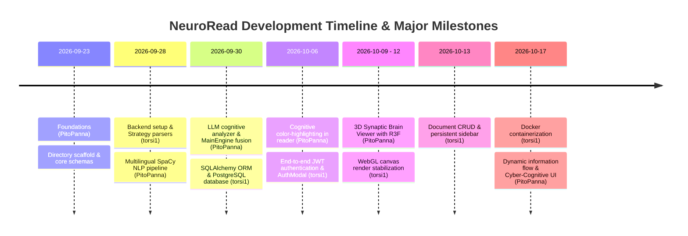
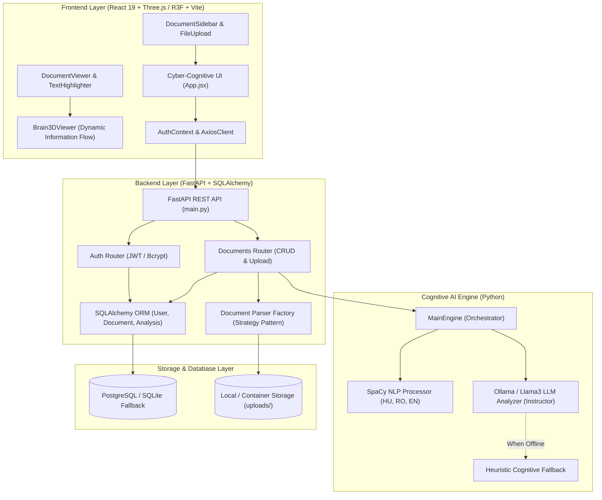

# 🧠 NeuroRead – Comprehensive System Documentation & Development Chronicle

> **Cognitive Text Intelligence and 3D Neural Information Flow Visualization Platform**  
> *Generated based on the NeuroRead repository git commit history, timestamps, and codebase architecture.*

---

## 📑 Table of Contents
1. [Executive Summary & Project Mission](#1-executive-summary--project-mission)
2. [Development Chronology & Git Commit History](#2-development-chronology--git-commit-history)
3. [System Architecture & Data Flow](#3-system-architecture--data-flow)
4. [Detailed Module Breakdown](#4-detailed-module-breakdown)
   - [4.1. Artificial Intelligence & Cognitive Engine (`src/ai_engine`)](#41-artificial-intelligence--cognitive-engine-srcai_engine)
   - [4.2. Backend REST Services (`src/backend`)](#42-backend-rest-services-srcbackend)
   - [4.3. Modern Cyber-Cognitive Frontend (`src/frontend`)](#43-modern-cyber-cognitive-frontend-srcfrontend)
   - [4.4. 3D Interactive Brain & Information Flow (`Brain3DViewer`)](#44-3d-interactive-brain--information-flow-brain3dviewer)
5. [Scientific Background: Cognitive Load & Neural Dynamics](#5-scientific-background-cognitive-load--neural-dynamics)
6. [API Endpoints & Communication Contracts](#6-api-endpoints--communication-contracts)
7. [Installation, Configuration & Deployment Guide](#7-installation-configuration--deployment-guide)
8. [Troubleshooting & Frequently Asked Questions (FAQ)](#8-troubleshooting--frequently-asked-questions-faq)
9. [Contributors & Developer Roles](#9-contributors--developer-roles)

---

## 1. Executive Summary & Project Mission

**NeuroRead** is an advanced cognitive science and artificial intelligence web platform designed to ingest multi-format text documents (PDF, DOCX, TXT), evaluate cognitive reading load (**Cognitive Load Theory**), and project real-time information processing pathways onto an interactive 3D human brain model.

Unlike conventional spell-checkers or text linters, NeuroRead models neurobiological and psycholinguistic reading comprehension dynamics:
- **Multilingual NLP Pipeline (SpaCy):** Calculates syntactic parse tree depth, sentence length distributions, rare word density, and classical readability metrics across Hungarian, Romanian, and English.
- **Semantic LLM Analysis (Ollama / Llama3 + Instructor):** Extracts abstract conceptual complexity, logic density, and working memory demand via strongly-typed Pydantic schemas.
- **3D Neural Information Flow (Three.js / React Three Fiber):** Projects how information travels through reading pathways between sensory perception (Visual Cortex), semantic comprehension (Wernicke's area), grammatical processing (Broca's area), and executive synthesis (Prefrontal Cortex).
- **Dual Information Flow Characteristics:**
  - *Smooth / Easy reading:* Calm, laminar green/cyan particle streaming with minimal variance.
  - *Complex / Dense reading:* High-velocity turbulent amber/red particle streams accompanied by feedback loops between executive and semantic hubs.

---

## 2. Development Chronology & Git Commit History

The project was developed in iterative phases through close collaboration between two core developers, **PitoPanna** and **torsi1**.

### 2.1. Git Commit History Table

| Timestamp (ISO) | Commit Hash | Author | Associated PR | Description & Key Milestone |
| :--- | :--- | :--- | :--- | :--- |
| **2026-09-23 22:52:40** | `fd77825` | **PitoPanna** | - | `feat(core): initialize project structure, schemas, and base engine` – Initial directory structure, base schemas, and engine scaffold. |
| **2026-09-28 11:24:50** | `5b80a4b` | **torsi1** | PR #1 (`b9dd2da`) | `feat(steup): initialize backend structure, mock api, schemas and frontend app` – Backend setup, mock API endpoints, Pydantic schemas, and Vite frontend. |
| **2026-09-28 13:02:15** | `356b3ba` | **torsi1** | PR #2 (`c65efcc`) | `feat(parser): implement multi-format text extraction using strategy pattern` – Strategy pattern parsers for multi-format text extraction (PDF, DOCX, TXT). |
| **2026-09-28 13:34:17** | `82daf00` | **PitoPanna** | PR #3 (`cf07fb6`) | `feat: configure multi-language NLP pipeline and requirements` – Configured multilingual SpaCy pipeline (HU, RO, EN) and engine requirements. |
| **2026-09-30 15:42:09** | `2c0c113` | **PitoPanna** | PR #19 (`a3d5b0b`) | `add LLM cognitiv module` – Integrated local LLM (Ollama/Llama3) for conceptual and semantic cognitive complexity assessment. |
| **2026-09-30 17:01:50** | `6095be7` | **PitoPanna** | PR #20 (`9a93aa7`) | `feat: main_engine + complete multi-lang nlp_processor` – Fused NLP stats and LLM outputs in `MainEngine`; finished multilingual processor. |
| **2026-09-30 17:25:53** | `495f804` | **PitoPanna** | PR #21 (`adcf7de`) | `endpoints` – FastAPI cognitive analysis endpoints and routes. |
| **2026-09-30 18:12:25** | `0f880a5` | **torsi1** | PR #23 (`653bb36`) | `feat(database): setup db connection and modular ORM entities with SQLAlchemy` – PostgreSQL database connectivity, User and Document ORM entities. |
| **2026-09-30 20:27:50** | `e5b02e5` | **torsi1** | PR #25 (`7cf6792`) | `feat: integrate API, fix document parsers and reorganize project models` – Connected API routes to database, refined parsers and reorganized schemas. |
| **2026-10-06 11:27:23** | `e4acfb1` | **PitoPanna** | PR #26 (`944da00`) | `feat: integrate cognitive color-highlighting into DocumentViewer` – Integrated sentence-level cognitive color highlights into DocumentViewer. |
| **2026-10-06 13:46:56** | `958b615` | **torsi1** | PR #31 (`9024cfd`) | `feat: add AuthContext, token interceptors, and styled auth navigation header` – JWT auth context, Axios bearer token interceptors, styled auth header. |
| **2026-10-06 20:51:38** | `6a98711` | **torsi1** | PR #32 (`07fbdc7`) | `feat: complete auth modal UI and update AuthContext for token persistence` – Glassmorphic modal UI for login/register, token persistence in localStorage. |
| **2026-10-09 22:25:33** | `b4d94c5` | **PitoPanna** | PR #33 (`6de3685`) | `feat(backend): add 3D synapse routes and brain activation schemas to LLM analyzer` – Added 3D spatial coordinates, synapse routes, and activation schemas. |
| **2026-10-12 10:11:37** | `e061aec` | **PitoPanna** | PR #34 (`488268a`) | `feat(frontend): integrate 3D synaptic brain viewer with R3F into DocumentViewer` – Embedded interactive Three.js / React Three Fiber 3D brain canvas. |
| **2026-10-12 21:45:40** | `b464550` | **torsi1** | PR #35 (`9cb75a7`) | `fix(frontend): resolve R3F canvas render error and document viewer refs` – Fixed canvas resize exceptions, mount/unmount cycles, and DOM ref conflicts. |
| **2026-10-13 10:40:01** | `ed3badf` | **torsi1** | PR #36 (`a0b32ec`) | `feat(backend): implement document CRUD and analysis endpoints` – Full document CRUD operations, re-analysis routes, and metadata queries. |
| **2026-10-13 20:40:52** | `39ac836` | **torsi1** | PR #38 (`cddbfdd`) | `feat: add document list sidebar` – Interactive document repository sidebar with format badges and quick search. |
| **2026-10-17 20:06:44** | `fb83df7` | **torsi1** | PR #40 (`d2b09f3`) | `Configure Docker and database setup` – Multi-container orchestration (`docker-compose.yml`) for PostgreSQL, FastAPI, and React Nginx. |
| **2026-10-17 23:39:50** | `0ba0eda` | **PitoPanna** | `feat/3d-brain-flow` | `feat: implement 3D brain cognitive information flow, redesign frontend UI, and fix backend/ai-engine issues` – Procedural brain geometry, laminar vs. turbulent information flow, Cyber-Cognitive UI overhaul, and offline fallback resilience. |

---

### 2.2. Development Phases & Evolution



#### Phase I: Architecture Inception & Strategy Parsers (Sep 23 – 28, 2026)
- **PitoPanna** initialized the core repository, schemas, and requirements for a multi-language NLP pipeline.
- **torsi1** implemented the **Strategy Pattern** for file parsing (`BaseParser`, `PDFParser`, `DocxParser`, `TxtParser`), decoupling document ingestion from the rest of the application.

#### Phase II: Hybrid AI Engine & Database Foundation (Sep 30, 2026)
- The hybrid cognitive model was established: combining deterministic syntactic parsing (SpaCy dependency tree depth, rare words) with generative intelligence (Ollama/Llama3 via Instructor).
- **PitoPanna** created `MainEngine` to fuse NLP metrics and LLM evaluations into a unified `CognitiveModel`.
- **torsi1** configured SQLAlchemy ORM models (`User`, `Document`, `AnalysisResult`) connected to PostgreSQL.

#### Phase III: Cognitive Reading Studio & Security (Oct 06, 2026)
- The text reader received its cognitive highlight system, color-coding sentences based on mental load.
- Comprehensive JWT authentication was built with secure password hashing (bcrypt), bearer token interceptors, and an interactive login/register modal.

#### Phase IV: 3D Synaptic Space Integration (Oct 09 – 12, 2026)
- 3D brain coordinates and activation schemas were introduced.
- React Three Fiber (R3F) and Drei were integrated to render a live 3D synaptic brain viewer, with render fixes ensuring stability across canvas resizes.

#### Phase V: Document Management & Containerization (Oct 13 – 17, 2026)
- Full document lifecycle management (CRUD) was completed with a persistent sidebar.
- Multi-container Docker deployment (`docker-compose.yml`) was configured for production readiness.

#### Phase VI: Dynamic Information Flow & Cyber-Cognitive Redesign (Oct 17, 2026)
- Complete rewrite of the 3D brain model: procedural cortical geometry with gyri/sulci, 900 synaptic cloud points, and 4 functional cognitive hubs.
- Implementation of **active cognitive information flow**: easy (laminar green/cyan) vs. difficult (turbulent amber/red with feedback loops).
- Full frontend redesign to a distinctive "Cyber-Cognitive Lab" glassmorphism aesthetic with built-in demo document loading and robust offline fallbacks.

---

## 3. System Architecture & Data Flow

NeuroRead utilizes a decoupled, three-tier client-server architecture:



### End-to-End Processing Workflow:
1. **Upload:** Client uploads a file (`POST /api/documents/upload`).
2. **Parsing:** `ParserFactory` identifies the MIME type and extracts clean text via the appropriate parser strategy.
3. **Cognitive Synthesis:** `MainEngine` executes parallel SpaCy syntactic scoring and LLM semantic evaluation.
4. **Model Assembly:** Sentences are scored, tagged, and compiled into a unified `CognitiveModel` with 3D activation vectors.
5. **Interactive Visualization:** The frontend renders color-coded sentence pills in `DocumentViewer` and animates information particle streams in `Brain3DViewer`.

---

## 4. Detailed Module Breakdown

### 4.1. Artificial Intelligence & Cognitive Engine (`src/ai_engine`)

- **`nlp_processor.py` (TextProcessor):**
  - Multi-language SpaCy pipelines: Hungarian (`hu_core_news_lg`), English (`en_core_web_sm`), Romanian (`ro_core_news_lg`).
  - Lazy loading: Language models are loaded into memory only on demand.
  - Dependency tree analysis: Computes syntactic parse tree depths to determine structural sentence complexity.
  - Readability & lexical metrics (`analyze_stats`): Word counts, sentence counts, Type-Token Ratio (lexical diversity), and average sentence length.
- **`llm_analyzer.py` (LLMAnalyzer):**
  - Connects to local LLMs (Ollama with `llama3:8b`) using the **Instructor** library for structured Pydantic extraction.
  - Extracts working memory load (`working_memory_load`: 0.0 – 1.0) and conceptual difficulty (`semantic_complexity_score`: 1 – 10).
  - Robust offline fallback: If Ollama is unavailable or times out (>4s), an NLP-based heuristic engine instantly computes proxy scores without failing the request.
- **`main_engine.py` (MainEngine):**
  - Fuses statistical NLP metrics with LLM semantic tags.
  - Produces unified `HighlightedSegment` lists and builds the complete `CognitiveModel` including 3D activation nodes and flow paths.

---

### 4.2. Backend REST Services (`src/backend`)

- **`parsers/` Package (Strategy Pattern):**
  - `base.py`: Defines the abstract `BaseParser` interface with `parse(file_path)` method.
  - `pdf_parser.py`: PyMuPDF / pdfplumber based extraction of text and metadata.
  - `docx_parser.py`: Paragraph and table extraction using `python-docx`.
  - `txt_parser.py`: Multi-encoding resilient text ingestion (UTF-8, ISO-8859-2, Windows-1250).
  - `factory.py`: Automatic parser resolution based on file extensions and MIME headers.
- **`core/security.py` & `routers/auth.py`:**
  - Password hashing with `passlib[bcrypt]`.
  - Standard OAuth2 Bearer token generation with configurable JWT expiry.
  - `get_optional_current_user`: Supports seamless guest exploration while preserving private storage for authenticated users.
- **`database/connection.py`:**
  - Production-ready PostgreSQL pooling.
  - Automatic fallback to local **SQLite** (`neuroread.db`) if PostgreSQL is not configured, enabling zero-config local testing.

---

### 4.3. Modern Cyber-Cognitive Frontend (`src/frontend`)

Built with **React 19**, **Vite**, and custom glassmorphism styles:
- **`App.jsx`:** Main workstation layout with sticky status navigation, hero section, active document session management, and feature cards.
- **`DocumentViewer.jsx` & `TextHighlighter.jsx`:**
  - Split-screen workspace: document reader on the left, synchronized 3D brain on the right.
  - Interactive pill marks colored by cognitive weight; clicking any sentence focuses the 3D brain on that specific cognitive state.
  - Real-time reading telemetry: word counts, estimated reading time, average cognitive load index, and color legend.
- **`FileUpload.jsx`:** Scanner-style dropzone supporting drag-and-drop and a **built-in interactive demo document loader** for instant testing without server dependencies.
- **`DocumentSidebar.jsx`:** Quick-access document repository with search filtering and file type badges.
- **`AuthModal.jsx`:** Glassmorphic modal for user registration and authentication.

---

### 4.4. 3D Interactive Brain & Information Flow (`Brain3DViewer`)

The centerpiece visualization component in `Brain3DViewer.jsx` is powered by **Three.js** and **React Three Fiber (R3F)**:

#### 1. Anatomical Architecture:
- **Procedural Cortical Mesh:** Two discrete hemispheres displaced by mathematical trigonometric noise simulating cerebral gyri (ridges) and sulci (grooves), plus distinct cerebellum and brainstem structures.
- **Neural Point Cloud:** 900 synaptic points breathing in a subtle ambient rhythm.
- **4 Functional Cognitive Hubs:**
  - **Visual Cortex (Occipital Lobe, `z: -2.3`):** Primary sensory gateway for reading.
  - **Wernicke's Area (Temporal Lobe, `x: -1.7, y: 0.1, z: 0.2`):** Semantic decoding and concept retrieval.
  - **Broca's Area (Frontal Lobe, `x: -1.4, y: 0.7, z: 1.2`):** Syntactic parsing and grammatical structuring.
  - **Prefrontal Cortex (Anterior Frontal Lobe, `z: 2.3`):** Working memory, executive synthesis, and contextual integration.

#### 2. Information Flow Pathways:
Information travels along **Cubic Bézier Curves** connecting cognitive hubs:
```
[Visual Cortex] ---> [Wernicke's Area] ---> [Broca's Area] ---> [Prefrontal Cortex]
                             ^                                           |
                             |----------- (Feedback Loop) ---------------|
```

- **Easy Mode (Laminar Flow):**
  - **Palette:** Emerald green & electric cyan (`#10b981`, `#06b6d4`).
  - **Dynamics:** Smooth, linear, coherent particle velocity with minimal dispersion.
  - **Cognitive Meaning:** Effortless comprehension; minimal working memory strain; no feedback rereading required.
- **Hard Mode (Turbulent Flow):**
  - **Palette:** Pulsing amber, orange, and cognitive red (`#f59e0b`, `#ef4444`).
  - **Dynamics:** High particle velocity, increased trajectory jitter, intensified core glow.
  - **Feedback Loop:** Active reverse stream from Prefrontal Cortex back to Wernicke's Area, modeling the cognitive rereading and disambiguation process.
- **Telemetry HUD:** Live status display showing active mode (Auto / Easy / Hard), simulated neural frequency (Hz), and active synapse count.

---

## 5. Scientific Background: Cognitive Load & Neural Dynamics

NeuroRead is grounded in **John Sweller's Cognitive Load Theory (CLT)** and cognitive neuroscience:

1. **Intrinsic Cognitive Load:**
   - Inherent intellectual complexity of the subject matter.
   - Modeled via semantic complexity scoring (`semantic_complexity_score`: 1–10).
2. **Extraneous Cognitive Load:**
   - Cognitive friction introduced by convoluted grammar, ambiguous phrasing, or excessive syntactic nesting.
   - Modeled via SpaCy dependency tree depth and average sentence length.
3. **Germane Cognitive Load:**
   - Mental effort dedicated to organizing and integrating new information into long-term mental schemata.
   - Modeled via synaptic co-activation between Wernicke's area and the Prefrontal Cortex.

### Color-Coded Cognitive Scale:
- 🟢 **Green (Score 1–3):** Light load. High readability, simple syntactic structures.
- 🔵 **Blue (Score 4–5):** Moderate / Germane load. Informative, standard sentence structures.
- 🟠 **Orange (Score 6–7):** High load. Complex syntactic nesting, abstract terminology.
- 🔴 **Red (Score 8–10):** Critical load. Dense technical or philosophical prose requiring heavy working memory retention.

---

## 6. API Endpoints & Communication Contracts

### 6.1. Authentication (`/api/auth`)
- `POST /api/auth/register`
  - Body: `{ "email": "user@example.com", "username": "user", "password": "securepassword" }`
  - Response: `{ "id": 1, "email": "user@example.com", "username": "user", "created_at": "..." }`
- `POST /api/auth/login`
  - Form Data: `username=user&password=securepassword`
  - Response: `{ "access_token": "ey...", "token_type": "bearer" }`
- `GET /api/auth/me`
  - Header: `Authorization: Bearer <token>`
  - Response: Current user profile information.

### 6.2. Documents & Cognitive Analysis (`/api/documents`)
- `POST /api/documents/upload`
  - Body: `multipart/form-data` with `file: UploadFile`
  - Response: `DocumentUploadResponse` containing extracted text, readability statistics, highlighted segments, and the `cognitive_model`.
- `GET /api/documents/`
  - Response: List of previously uploaded documents for the user or session.
- `GET /api/documents/{document_id}`
  - Response: Full document details, parsed content, and saved analysis results.
- `DELETE /api/documents/{document_id}`
  - Response: Confirmation of successful deletion.
- `POST /api/documents/{document_id}/analyze`
  - Response: Re-analyzed document metrics and fresh cognitive model.

### 6.3. Direct AI Analysis (`/api/ai`)
- `POST /api/ai/analyze-text`
  - Body: `{ "text": "...", "language": "en" }`
  - Response: Sentence-level cognitive weights and highlighted spans.
- `POST /api/ai/cognitive-model`
  - Response: 3D coordinates, synapse nodes, and flow vectors.

---

## 7. Installation, Configuration & Deployment Guide

### 7.1. Prerequisites
- **Operating System:** Windows 10/11, macOS, or Linux (Ubuntu 20.04+)
- **Python:** 3.10, 3.11, or 3.13
- **Node.js:** v18.0.0 or higher (npm v9+)
- **Docker & Docker Compose:** (Optional, for containerized execution)
- **Ollama:** (Optional, for local Llama3 inference)

---

### 7.2. Local Development Setup

#### Step 1: Clone Repository
```bash
git clone https://github.com/PitoPanna/NeuroRead.git
cd NeuroRead
```

#### Step 2: Python Virtual Environment & Dependencies
```bash
# Create and activate virtual environment (Windows PowerShell)
python -m venv .venv
.\.venv\Scripts\Activate.ps1

# Install requirements
pip install -r src/backend/requirements.txt
pip install -r src/ai_engine/requirements.txt

# Download required SpaCy language models
python -m spacy download hu_core_news_lg
python -m spacy download en_core_web_sm
python -m spacy download ro_core_news_lg
```

#### Step 3: Environment Configuration (`.env`)
Create a `.env` file in the project root:
```env
# Database (defaults to local SQLite if omitted)
DATABASE_URL=sqlite:///./neuroread.db

# Security & JWT
SECRET_KEY=neuroread_super_secret_jwt_key_2026_change_in_production
ALGORITHM=HS256
ACCESS_TOKEN_EXPIRE_MINUTES=1440

# Cognitive AI Configuration
OLLAMA_BASE_URL=http://localhost:11434
OLLAMA_MODEL=llama3:8b
```

#### Step 4: Launch Backend Server
```bash
python -m uvicorn src.backend.main:app --host 0.0.0.0 --port 8000 --reload
```
*Interactive Swagger documentation: `http://localhost:8000/docs`*

#### Step 5: Launch Frontend Application
```bash
cd src/frontend/vite-project
npm install
npm run dev
```
*Frontend interface: `http://localhost:5173`*

---

### 7.3. Multi-Container Docker Deployment

To launch the full stack (PostgreSQL, FastAPI backend, Nginx React frontend) via Docker Compose:

```bash
docker-compose up --build -d
```

- **Frontend Client:** `http://localhost:80`
- **Backend API:** `http://localhost:8000`
- **PostgreSQL Database:** Port `5432`

---

## 8. Troubleshooting & Frequently Asked Questions (FAQ)

### Q1: What are the two white/glowing spheres inside the 3D brain model?
> **Answer:** The two bright spherical hubs represent the primary language centers in the left hemisphere: **Wernicke's Area** (semantic decoding) and **Broca's Area** (syntactic structure and motor speech formulation). They function as **pulsing cognitive hubs**; their pulse rate and intensity increase in real time according to the cognitive load of the text currently in focus.

### Q2: What happens if Ollama is offline or not installed?
> **Answer:** The system was engineered for continuous resilience. If Ollama is offline or times out (>4 seconds), the `LLMAnalyzer` automatically engages a **heuristic cognitive fallback**. It evaluates SpaCy syntactic parse tree depth, sentence length variance, and vocabulary rarity to generate accurate cognitive scores without throwing errors.

### Q3: What happens if PostgreSQL is not running?
> **Answer:** The database connection manager (`connection.py`) includes an automatic fallback. If `DATABASE_URL` is omitted or PostgreSQL fails to connect, the system creates and utilizes a local SQLite database (`neuroread.db`).

### Q4: Can I test the platform without registering or uploading files?
> **Answer:** Yes. The application fully supports guest sessions. Clicking the **"Kognitív minta betöltése" (Load Cognitive Demo)** button on the upload card immediately loads a pre-analyzed sample text demonstrating easy and hard paragraphs, triggering the 3D brain information flow instantly.

---

## 9. Contributors & Developer Roles

| Developer | Role & Key Contributions |
| :--- | :--- |
| **PitoPanna** | **Lead System Architect & AI/3D Engineer**<br>• Core architecture design and Pydantic schemas<br>• Multilingual SpaCy NLP pipeline & Ollama/Instructor LLM integration<br>• 3D Synaptic Brain visualization & dynamic information flow (`Brain3DViewer`)<br>• Cyber-Cognitive Lab UI redesign & sentence-level color-highlighting |
| **torsi1** | **Backend Architect & Infrastructure Engineer**<br>• Strategy-pattern document parsers (PDF, DOCX, TXT)<br>• SQLAlchemy ORM entities & PostgreSQL database management<br>• JWT authentication architecture (AuthContext, token interceptors, AuthModal)<br>• Document CRUD routes & sidebar repository integration<br>• Multi-stage Docker & Docker Compose containerization |

---

*Documentation finalized: October 18, 2026.*  
*NeuroRead – Illuminating the Flow of Human Thought.*

